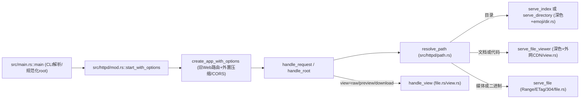
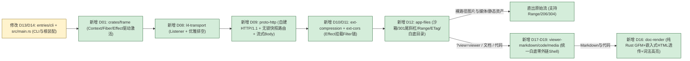

# d 阶段 1–3 可执行施工手册与 Goal 驱动入口

本文件是 `d` 项目的**唯一施工入口、测试验收规范与跨会话接续手册**，必须配合总架构文档 [architecture.md](architecture.md) 与框架层契约文档 [frame.md](frame.md) 一起使用。

> **当前状态声明**：本轮仅完成施工前置准备与设计定稿，**尚未启动任何业务代码编写、测试源码编写、构建试跑或持续目标执行**。全部施工项（`C01`–`C32`）与验收项（`A01`–`A32`）均保持未勾选状态。

---

## 1. 目标、当前基线与准备状态

### 本次交付完整边界（阶段 1–3 全闭环）

完成本手册全部阶段后，用户将获得一个结构彻底分层、核心自主可控、完全离线可用的 `d` 网络守护进程与内容服务：

1. **阶段 1（`P1`）— 第 0 层独立框架微内核 `crates/frame/`**：
   - 零外部依赖（仅依赖 Rust 标准库 `std`），提供强类型 `Service` 与 `Scope` 隔离、响应式 `Fiber` 状态机与级联刷新、异步 `Effect` 逆序与并发资源回收、四类语义强类型事件总线、增量热更新 `Loader` 与脱敏 `Inspect`。
2. **阶段 2（`P2`）— Cargo Workspace 分层重构、L4 传输核心、自建底层 HTTP 引擎与基础应用迁移**：
   - 将根仓库升级为多包 Workspace（`crates/frame`、`crates/contracts/*`、`crates/components/*`、`crates/entries/*` 与根装配包 `d`）；
   - 从零构建不依赖重型上层框架的 `l4-transport`（连接台账与优雅排空）与 `proto-http`（底层 HTTP/1.1 解析与流式写出、控制面 `Effect` 注册、数据面无锁不可变快照路由与过滤器链、流式上下文豁免缓冲标记）；
   - 将压缩与 CORS 下沉为第 3 层插件（`ext-compression`、`ext-cors`），将文件服务与安全沙箱迁入第 4 层 `app-files`，补齐目录缺少尾斜杠的规范化重定向；
   - 保持现有命令行参数、环境变量及全部基础 HTTP 语义无缝工作，并彻底移除旧扁平 `src/httpd/` 实现，不保留双套路径。
3. **阶段 3（`P3`）— 完善内建 Markdown、轻量词法高亮、极简白色 UI 与媒体展示层**：
   - 落地零外部依赖纯 Rust 文档渲染包 `doc-render`：完整 CommonMark + GFM（表格、任务列表、删除线、脚注、自动链接）、**原生块级与行内嵌入式 HTML 透传**、中英文唯一标题锚点、相对/根相对/外链图片适配及纯 Rust 轻量词法语法高亮；
   - 落地 `viewer-markdown`、`viewer-code`、`viewer-media` 与统一极简白底 UI 壳（纯白 `#ffffff` 画布，全面清除深色背景、emoji 堆砌、彩色徽标与全部外部脚本/样式链接）；
   - 严格落实无冲突内容路由（图片/音视频/样式/脚本裸路径直出原流，文档/代码默认进白底查看页，媒体通过 `?view=viewer` 进白底展示页），更新示例集、端到端验收脚本与干净重建校验。

**非本轮阻塞范围（架构已预留扩展位，留待后续独立里程碑）**：
- 阶段 4（声明式配置文件热加载与开发工作流提效扩展：本地自动 HTTPS、多服务聚合反代、Mock、Live Reload、流式检视器）；
- 阶段 5（WebSocket / 原生 TCP 协议引擎、L7/L4 反向代理、负载均衡、健康检查、自动 TLS 与多协议应用示范）。

### 当前基线快照（实测事实）

- **仓库位置**：工作区根目录 `.`（正文与代码中严禁写入本机绝对路径）
- **基线分支与提交**：`master` @ `eb012ac`（`fix: strip directories with '/' only in content_disposition`）
- **工具链与环境**：`rustc 1.98.1`、`cargo 1.98.1`、`rustfmt`、`clippy`、`bash`、`curl`，目标分区剩余可用磁盘 `157G`
- **工作区当前未提交文件**：仅包含两份已编写的设计文档 `docs/architecture.md`、`docs/frame.md` 与本手册 `docs/construction.md`，源码树保持基线 `eb012ac` 未改动
- **仓库硬约束**：
  - `.github/workflows/ci.yml`：要求跨平台通过 `cargo fmt --check`、`cargo clippy --all-targets -- -D warnings`、`cargo test` 与 Unix 下 `scripts/acceptance.sh`；
  - `rustfmt.toml`：严格 `max_width = 80`、`tab_spaces = 4`、`newline_style = "Unix"`、`reorder_imports = true`。

### 准备状态核查表

| 准备维度 | 已确认事实与资料位置 | 当前状态 | 缺口与影响步骤 | 解除条件 |
| :--- | :--- | :--- | :--- | :--- |
| 需求与非目标 | 需求 `Q01`–`Q15` 及阶段 1–3 / 阶段 4–5 边界已写入本手册第 2 节 | 已具备 | 无阻塞缺口 | 用户拍板授权启动即可进入 `P1` |
| 当前/目标与设计 | 现状树/流程图（1.1）、目标树/差异图（2.2）与 [architecture.md](architecture.md) 一致 | 已具备 | 无阻塞缺口 | — |
| 结构与契约 | `frame` 全套接口见 [frame.md](frame.md)；阶段 2/3 各包数据结构与方法签名见第 2 节 | 已具备 | 无阻塞缺口 | — |
| 环境与资源 | `rustc 1.98.1`、`cargo 1.98.1`、`rustfmt`、`clippy`、`curl` 就绪，磁盘充足 | 已具备 | 无阻塞缺口 | — |
| 测试与验收设计 | BDD 场景、`T-F01`–`T-M10` 具体样例、计时与隔离标准及 `A01`–`A32` 清单已写入第 4 节 | 已具备 | 仅编写于文档，测试源码待 TDD Red 阶段落实 | 进入对应阶段 `Red` 步骤写入源码 |
| 施工与接续 | 唯一施工清单 `C01`–`C32`、进度看板（第 5 节）、恢复入口（第 6 节）与 Goal 文案（第 7 节）已齐备 | 已具备 | 未启动实现、测试或 Goal | 发起 `/goal` 即从 `P1 / C01` 开工 |
| 交付与善后 | 沿用仓库签名提交与 CI 门禁要求，阶段完成清理临时测试输出并跑干净重建 | 已具备 | 阶段 3 收尾时执行 | — |

**准备交付核对**（仅代表前置资料已写齐，不表示任何产品代码或测试已通过）：
- [x] 需求范围、生效设计与阶段边界明确，无第三方项目名残留；
- [x] 当前基线、目标结构与逐文件差异表对齐真实行号与符号；
- [x] 施工清单 `C` 与验收清单 `A` 独立分表且与测试样例 `T` 一一绑定；
- [x] 完整可复制 `/goal` 驱动文案已就绪，未擅自启动实现或测试。

---

### 1.1 当前全貌：源码树与架构图景

#### 当前源码树（基线 `eb012ac`，省略 `target/` 与 `.git/`）

```text
.
├── Cargo.toml                  # 单体包 d (edition=2024, MSRV=1.88)，含重型 Web/CLI/编码/序列化外链依赖
├── rustfmt.toml                # 代码格式约束 (80 列, 4 空格, Unix 换行)
├── .github/workflows/ci.yml    # CI：fmt + clippy(-D warnings) + test + acceptance.sh + semver + audit
├── src/
│   ├── lib.rs                  # L1-5: 导出 error, httpd, utils 及 httpd::{Options, start, start_with_options}
│   ├── main.rs                 # L1-147: Cli 参数与环境变量解析、日志订阅初始化、规范化 root 后调用 start_with_options
│   ├── error.rs                # L1-28: Error 枚举与 HTTP 状态码映射
│   ├── utils.rs                # L1-63: 依赖外部编解码/MIME/日期库的路径编解码、大小格式化与日期格式化
│   └── httpd/
│       ├── mod.rs              # L1-410: ServerState、Options、SortBy、RequestQuery、路由绑定、handle_request/view/path/dir、serve_index
│       ├── path.rs             # L1-172: PathResolution、sanitize_path、resolve_path（含 8 个单测）
│       ├── file.rs             # L1-542: ByteRange、parse_range、generate_etag、is_not_modified、serve_file/raw/download（含 15 个单测）
│       ├── dir.rs              # L1-609: FileEntry、FileType(emoji/颜色)、list_directory_entries、generate_breadcrumb、深色目录 HTML
│       ├── view.rs             # L1-482: serve_preview、serve_file_viewer(9条外网CDN/深色UI)、render_markdown_content(转义破坏HTML)
│       └── html.rs             # L1-9: html_escape
├── tests/http.rs               # L1-518: 25 个内存请求集成测试（直接耦合旧 Web 路由类型）
├── scripts/acceptance.sh       # L1-221: 真实进程端到端 HTTP 验收脚本
├── examples/                   # demo/, code/, docs/, media/, static-site/ 与 README.md
└── docs/
    ├── index.html & pages/     # 项目主页展示源码（本轮不改动）
    ├── architecture.md         # 五层总体架构设计（已写）
    └── frame.md                # 第 0 层 frame 接口与契约设计（已写）
```

**当前主要缺口与问题定位**：
1. 无分层与插件微内核：所有生命周期、传输监听、路由、压缩、CORS、文件响应、HTML 渲染耦合在 `src/httpd/`；
2. 依赖外网脚本：[`src/httpd/view.rs:L87-L96`](../src/httpd/view.rs#L87-L96) 硬编码 9 条外部样式表与前端 Markdown/代码高亮脚本链接；
3. 嵌入式 HTML 被破坏：[`src/httpd/view.rs:L363-L373`](../src/httpd/view.rs#L363-L373) 对整篇 Markdown 调用 `html_escape` 后交给浏览器脚本，导致文档内嵌 HTML 原样显示成文本或失效；
4. 深色重装饰界面：[`src/httpd/view.rs:L99-L294`](../src/httpd/view.rs#L99-L294) 与 [`src/httpd/dir.rs:L356-L461`](../src/httpd/dir.rs#L356-L461) 使用黑色背景（`#0d1117`/`#161b22`），[`src/httpd/dir.rs:L80-L112`](../src/httpd/dir.rs#L80-L112) 及 `L584-L588` 堆砌 emoji 与彩色胶囊标签；
5. 目录路径基准缺口：[`src/httpd/mod.rs:L300-L312`](../src/httpd/mod.rs#L300-L312) 访问无末尾 `/` 的目录时直接返回页面而非重定向到带 `/` 目录地址，导致文档与静态页内的相对图片路径错位。

#### 当前调用流程图



---

## 2. 需求、设计与前置缺口

### 需求清单（`Q01`–`Q15`）

| 需求 ID | 类型 | 明确要求 / 决定内容 | 对应层次 |
| :--- | :--- | :--- | :--- |
| `Q01` | 明确要求 | 建立独立通用第 0 层框架包 `frame`（暂驻工作区 `crates/frame/`），零外部依赖（纯 `std`），承载 `Context`/`Scope`/`Service`/`Fiber`/`Effect`/`Event`/`Loader`/`Inspect` | 第 0 层 |
| `Q02` | 明确要求 | 以契约包（`contracts/*`）、组件实现（`components/*`）、入口壳（`entries/*`）与根装配 `d` 分层组织，禁止组件跨界直连实现 | 工作区 |
| `Q03` | 明确要求 | 第 1 层 `l4-transport` 独立封装地址监听、连接计数台账、信号接入与分阶段优雅排空 | 第 1 层 |
| `Q04` | 明确要求 | 第 2 层 `proto-http` 基于底层异步字节流自建 HTTP/1.1 协议引擎，控制面经 `Effect` 注册，数据面使用原子不可变快照零锁路由，支持流式不缓冲标记 | 第 2 层 |
| `Q05` | 明确要求 | 将压缩与 CORS 下沉为第 3 层扩展插件（`ext-compression` 流式感知自动跳过 SSE/206/已压缩体；`ext-cors` 默认关闭，开启按规则放行） | 第 3 层 |
| `Q06` | 明确要求 | 将原文件服务器迁入第 4 层 `app-files`，完整保留既有沙箱安全、`Range`（206/416）、`ETag`/`Last-Modified`/`304`、`HEAD`、RFC 5987 下载、`index.html`/`?listing=true`、排序与隐藏切换 | 第 4 层 |
| `Q07` | 明确要求 | 修复目录缺少末尾 `/` 访问时自动 `301` 规范化重定向（保留查询参数），确保相对资源与图片链接基准正确 | 第 4 层 |
| `Q08` | 明确要求 | 彻底移除全部外部脚本/样式 CDN 链接与前端解析闪烁，页面 100% 离线自包含 | 展示层 |
| `Q09` | 明确要求 | 自建纯 Rust 零外部依赖 `doc-render`：完整支持 CommonMark + GFM（表格/对齐/任务列表/删除线/脚注/自动链接）及中英文标题锚点 | 展示层 |
| `Q10` | 明确要求 | Markdown 原生支持块级与行内嵌入式 HTML 透传（`<details>`、``、`<table>`、`<figure>`、`<video>`、`<kbd>` 等）及相对/根相对/外链图片正常显示 | 展示层 |
| `Q11` | 明确要求 | 自建纯 Rust 轻量词法代码高亮与内置浅色样式，覆盖主流编程语言、脚本、配置与查询语言 | 展示层 |
| `Q12` | 明确要求 | 全站统一为极简白色界面（`#ffffff` 背景、`#f6f8fa` 代码/表头底、`#e5e7eb` 边框、`#1f2328` 正文、`#656d76` 元信息、`#0969da` 单一强调蓝），移除全部深色背景、emoji 堆砌与彩色徽标 | 展示层 |
| `Q13` | 明确要求 | 落实无冲突内容路由：图片/音频/视频/样式/脚本/二进制裸路径直出原流，目录页提供 `?view=viewer` 打开白底媒体查看页；文档/代码默认进白底展示页，`?view=raw`/`preview`/`download` 保持一致 | 第 4 层 |
| `Q14` | 明确要求 | 保持现有 CLI 参数、环境变量及 `d::{Options, create_app_with_options, start, start_with_options}` 向后可用，移除旧 `src/httpd/` 扁平实现 | 入口/装配 |
| `Q15` | 非目标 | 本轮不提前实现阶段 4 配置文件热加载/本地 HTTPS/Mock/LiveReload/检视器与阶段 5 WS/TCP/反代应用，但所有第 1/2 层契约必须预留干净扩展位且保持单套无版本化设计 | 边界约束 |

### 各层包结构、接口与核心逻辑设计

> 第 0 层 `crates/frame/` 的全部结构体、枚举、Trait、状态机、锁规则与 `F01`–`F10` 契约已在 [frame.md](frame.md) 中精确定义，以下补充阶段 2 与阶段 3 各包的精确可执行规格。

#### 1. `crates/contracts/net-api`（纯 `std` + 依赖 `frame`）

- `pub type BoxStreamIo = Box<dyn AsyncByteIo>;`（定义统一异步字节读写 trait `AsyncByteIo: AsyncRead + AsyncWrite + Unpin + Send + 'static`；或与最小异步运行时 I/O Trait 对齐，屏蔽底层具体网络库类型）。
- `pub enum ConnectionKind { ShortLived, LongLived }`
- `pub struct ConnectionMeta { pub id: u64, pub remote_addr: std::net::SocketAddr, pub kind: ConnectionKind }`
- `pub trait DrainSignal: Send + Sync { fn wait(&self) -> frame::BoxFuture<'static, ()>; }`
- `pub trait ConnectionHandler: Send + Sync + 'static`:
  - `fn handle(&self, io: BoxStreamIo, meta: ConnectionMeta, drain: Arc<dyn DrainSignal>) -> frame::BoxFuture<'static, ()>;`
- `pub trait TransportService: frame::Service`:
  - `fn listen(&self, addr: std::net::SocketAddr, handler: Arc<dyn ConnectionHandler>) -> frame::BoxFuture<'static, Result<(std::net::SocketAddr, frame::EffectHandle), frame::FrameError>>;`
  - 返回真实绑定的 `SocketAddr`（支持传 `127.0.0.1:0` 分配随机端口供测试并发隔离），停止/注销 `EffectHandle` 时自动关闭对应监听器并排空所属连接。

#### 2. `crates/contracts/http-api`（纯 `std` + 依赖 `frame` + `net-api`）

- 核心值类型（自建零外部依赖）：
  - `Method { Get, Head, Post, Put, Delete, Options, Patch, Other(String) }`（提供 `as_str()`, `from_bytes(&[u8])`）
  - `StatusCode(pub u16)`（内置常量 `OK(200)`, `MOVED_PERMANENTLY(301)`, `NOT_MODIFIED(304)`, `PARTIAL_CONTENT(206)`, `BAD_REQUEST(400)`, `FORBIDDEN(403)`, `NOT_FOUND(404)`, `METHOD_NOT_ALLOWED(405)`, `PAYLOAD_TOO_LARGE(413)`, `URI_TOO_LONG(414)`, `RANGE_NOT_SATISFIABLE(416)`, `HEADER_FIELDS_TOO_LARGE(431)`, `INTERNAL_SERVER_ERROR(500)`, `HTTP_VERSION_NOT_SUPPORTED(505)` 及 `reason_phrase(&self)`）
  - `Version { Http10, Http11 }`
  - `Headers`：内部 `Vec<(String, String)>`，提供 `insert`, `append`, `get(&str) -> Option<&str>`（大小写不敏感匹配）、`get_all(&str)`、`remove(&str)`、`iter()`、`contains(&str)`。
  - `Body`：
    ```rust
    pub enum BodyKind {
        Empty,
        Bytes(Vec<u8>),
        Stream {
            reader: Box<dyn AsyncByteStream>,
            content_length: Option<u64>,
            streaming: bool, // 为 true 时禁止中间件全量缓冲与整包压缩
        },
    }
    ```
  - `HttpRequest`：`method: Method`, `raw_uri: String`, `path: String`, `query: Option<String>`, `version: Version`, `headers: Headers`, `body: BodyKind`, `remote_addr: Option<SocketAddr>`。提供 `query_param(&self, key: &str) -> Option<String>` 辅助方法。
  - `HttpResponse`：`status: StatusCode`, `headers: Headers`, `body: BodyKind`；提供链式构造器 `empty(status)`, `bytes(status, content_type, data)`, `html(status, html)`, `text(status, text)`, `redirect_moved(location)` 等。
- 路由与过滤器契约：
  - `RouteMatch { Exact(String), Prefix(String), CatchAll }`
  - `RouteSpec { pub id: String, pub host: Option<String>, pub matcher: RouteMatch, pub methods: Option<Vec<Method>>, pub priority: i32 }`
  - `HttpHandler`: `fn call(&self, req: HttpRequest) -> frame::BoxFuture<'static, HttpResponse>;`
  - `FilterOutcome { Continue(HttpRequest), Respond(HttpResponse) }`
  - `HttpFilter`:
    - `fn priority(&self) -> i32`
    - `fn on_request(&self, req: HttpRequest) -> frame::BoxFuture<'static, FilterOutcome>`
    - `fn on_response(&self, req_meta: &RequestMeta, resp: HttpResponse) -> frame::BoxFuture<'static, HttpResponse>`（其中 `RequestMeta` 保留 `method`, `path`, `headers`, `is_head` 供压缩与 CORS 等响应过滤器判断）
  - `RouterService: frame::Service`:
    - `fn mount_route(&self, spec: RouteSpec, handler: Arc<dyn HttpHandler>) -> Result<frame::EffectHandle, frame::FrameError>;`
    - `fn mount_filter(&self, filter: Arc<dyn HttpFilter>) -> Result<frame::EffectHandle, frame::FrameError>;`
    - `fn dispatch(&self, req: HttpRequest) -> frame::BoxFuture<'static, HttpResponse>;`（供无端口内存集成测试直接注入请求并取得完整 `HttpResponse`！）

#### 3. `crates/contracts/files-api` & `crates/contracts/render-api`（纯 `std` + `frame` + `http-api`）

- `files-api`:
  - `FileCategory { Directory, Image, Video, Audio, Code, Text, Markdown, Org, Archive, Document, Executable, Unknown }`
  - `ViewMode { Default, Raw, Preview, Download, Viewer }`
  - `ViewerInput<'a> { pub rel_path: &'a str, pub file_name: &'a str, pub full_path: &'a Path, pub size: u64, pub modified: Option<SystemTime>, pub category: &'a FileCategory, pub view_mode: ViewMode, pub bytes_or_text: Option<&'a str> }`
  - `FileViewer: Send + Sync + 'static`: `fn name(&self) -> &str`, `fn priority(&self) -> i32`, `fn supports(&self, category: &FileCategory, mode: ViewMode) -> bool`, `fn render(&self, input: ViewerInput<'_>) -> Option<HttpResponse>`
  - `ViewerRegistryService: frame::Service`: `fn register(&self, viewer: Arc<dyn FileViewer>) -> Result<frame::EffectHandle, frame::FrameError>;`
- `render-api`:
  - `pub type HtmlSanitizer = Arc<dyn Fn(&str) -> String + Send + Sync>;`
  - `MarkdownOptions { pub allow_raw_html: bool, pub heading_anchors: bool, pub sanitizer: Option<HtmlSanitizer> }`
  - `HeadingEntry { pub level: u8, pub text: String, pub id: String }`
  - `RenderedDocument { pub html: String, pub headings: Vec<HeadingEntry> }`
  - `RenderService: frame::Service`:
    - `fn render_markdown(&self, src: &str, opts: &MarkdownOptions) -> RenderedDocument;`
    - `fn highlight_code(&self, lang: &str, code: &str) -> String;`
    - `fn highlight_stylesheet(&self) -> &'static str;`

#### 4. 第 1 层 `crates/components/l4-transport` & 第 2 层 `crates/components/proto-http`

- `l4-transport`：
  - 基于最基础的异步 TCP 监听与任务调度实现 `DefaultTransportService`；
  - 维护 `ConnectionLedger`（活跃连接映射 + 原子计数 + 全部连接退出唤醒通知）与 `DrainCoordinator`；
  - 停止监听或全局关停时：立即停止 `accept` 新连接 → 等待 `ShortLived` 连接完成 → 通知 `LongLived` 连接排空并附带可配置排空硬超时上限（避免异常对端卡死停机）。
- `proto-http`：
  - **自建 HTTP/1.1 协议状态机**：
    - 带边界保护的请求解析：单请求行长度上限（8 KB）、单头部字段数上限（128 条）与总头部字节上限（64 KB），超限分别准确回复 `414` / `431`；格式错误回复 `400`；不支持版本（非 HTTP/1.0、1.1）回复 `505`；
    - 正确处理 `Content-Length` 与 `Transfer-Encoding: chunked` 请求体，正确判定 `Connection: close` 与 HTTP/1.1 默认持久连接复用（Keep-Alive）；
    - 响应写出器：支持 `Empty`（含 `HEAD` 保留原 `Content-Length` 但零 body）、`Bytes`、`Stream`（有 `content_length` 时按流分块直写，无长度或 `streaming == true` 时使用 Chunked 逐块写入并每次立即 `flush`，确保 SSE/大文件零缓冲与恒定低内存）；
    - 自动补齐 `Date` 响应头与缺省 `Connection` 头。
  - **控制面与数据面分离**：
    - `HttpRouter` 实现 `RouterService`；控制面 `mount_route` / `mount_filter` 使用内部写锁更新源列表并向所属上下文注册卸载 `Effect`；每次增删立即编译生成按权重/匹配精度排好序的不可变 `RoutingSnapshot`（包含排序后路线列表与双向过滤链），通过 `Arc<RwLock<Arc<RoutingSnapshot>>>` 或原子指针发布；数据面 `dispatch` 仅取快照 `Arc::clone` 后立即无锁顺序执行 `on_request` → 命中路由 `HttpHandler` → 逆序执行 `on_response`。

#### 5. 第 3 层 `ext-compression` & `ext-cors`

- `ext-compression`（依赖底层基础无损压缩编码库）：
  - 解析请求 `Accept-Encoding` 权重列表（优先级支持 `br` / `gzip` / `deflate`）；
  - **流式感知豁免条件**（任一满足即原样透传、不压缩、不缓冲）：
    - `RequestMeta.is_head == true`；
    - `resp.status` 为 `206` / `304` / `< 200`；
    - `resp.headers.contains("content-encoding")` 或 `resp.headers.get("cache-control")` 含 `no-transform`；
    - `BodyKind::Stream { streaming: true, .. }` 或 `Content-Type` 为 `text/event-stream`；
    - 响应已属于压缩格式（`image/png`, `image/jpeg`, `image/webp`, `image/avif`, `video/*`, `audio/*`, `application/gzip`, `application/zip`, `application/zstd`, `application/br`）；
    - `BodyKind::Empty` 或静态 `Bytes` 小于最小阈值（如 256 字节）；
  - 压缩生效时：替换 `BodyKind`、移除原 `Content-Length` 或更新为压缩后长度、设置 `Content-Encoding` 与 `Vary: Accept-Encoding`。
- `ext-cors`（纯 `std` 零外部依赖）：
  - 默认可禁用（不挂载插件）；启用后在 `on_request` 拦截 `OPTIONS` 预检并直接响应 `204`/`200`（带 `Access-Control-Allow-Origin: *`、`Access-Control-Allow-Methods: GET, HEAD, OPTIONS`、`Access-Control-Allow-Headers: *`），在 `on_response` 为所有响应注入 `Access-Control-Allow-Origin: *`。

#### 6. 第 3/4 层 `doc-render`、`app-files`、`viewer-*` 与极简白底 UI Shell

- `crates/components/doc-render`（**纯 `std` 零外部依赖**）：
  - **两阶段 Markdown 解析与渲染引擎**：
    - **预处理与引用收集**：规范化换行（`\r\n` → `\n`），解析链路引用定义 `[label]: url "title"` 与脚注定义 `[^id]: ...`；
    - **块级解析状态机**：支持 `#`..`######` ATX 标题与 `===`/`---` Setext 标题（生成兼容中英文、去重 `-1`/`-2` 的稳定 slug `id` 与锚点跳转）、围栏代码块（```` ``` ```` / `~~~`，支持任意长度围栏嵌套、语言提取与词法高亮）、缩进代码块、引用块（`>` 支持多层嵌套与内含列表/表格）、无序/有序列表（支持多层缩进、松紧列表与 GFM 任务列表 `- [ ]` / `- [x]`）、分隔线（`---`/`***`/`___`）、GFM 管道表格（`| a | b |` 与 `:---`/`:---:`/`---:` 对齐）、**原生块级嵌入式 HTML 原样透传**（支持 `<details>`, `<figure>`, `<table>`, `<div>`, `<section>`, `<video>`, `<audio>`, `<iframe>` 等多行块及 HTML 注释 `<!-- ... -->`）；
    - **行内解析状态机**：支持反斜杠转义、行内代码（变长反引号 `` ``a ` b`` ``）、强调 `*...*` / `_..._`、加粗 `**...**` / `__...__`、删除线 `~~...~~`、行内链接 `[text](url "title")`、引用链接 `[text][ref]`、`` 图片、自动链接 `<https://...>` 与裸 URL 识别、脚注引用 `[^id]`（文末渲染有序脚注区与返回跳转）、**原生行内嵌入式 HTML 原样透传**（``, `<kbd>`, `<br>`, `<mark>`, `<sub>`, `<sup>`, `<span ...>` 等，不对标签做 `html_escape`）；
    - 预留可选 `sanitizer` 钩子：当传入 `None`（默认本地可信模式）时保留嵌入式 HTML；当传入过滤钩子时过一层自定义清洗。
  - **纯 Rust 轻量词法语法高亮器**：
    - 基于状态扫描（注释、多行注释、字符串/原始字符串/转义、数字字面量、关键字/内置类型/宏或注解/标识符、标点运算符），内置覆盖 `rust`, `javascript`, `typescript`, `python`, `go`, `c`, `cpp`, `bash`/`sh`, `json`, `yaml`, `toml`, `sql`, `html`, `css`, `markdown`；
    - 输出干净语义化标签 `<span class="hl-kw">...</span>`（`hl-kw`, `hl-ty`, `hl-str`, `hl-num`, `hl-cmt`, `hl-fn`, `hl-attr`）配合内建浅色高亮 CSS，零外部脚本、零额外字体。
- `crates/components/app-files`（核心文件服务）：
  - **纯 `std` 内建基础设施**：内置常用后缀 MIME 映射表（涵盖 web/文档/代码/图片/音视频/字体/压缩包，未知回退 `application/octet-stream`）、自建 RFC 3986 百分号编解码、自建 RFC 9110 IMF-fixdate 格式化与 `If-Modified-Since` 解析（支持 `IMF-fixdate` 与 RFC 850/asctime 兼容读取）；
  - **路径安全与尾斜杠规范**：`resolve_path` 词法清洗 + `canonicalize` + 沙箱前缀核查，越界或缺失统一 `404`；请求 `/favicon.ico` 保持 `404`；若解析为目录且原始请求路径不以 `/` 结尾，返回 `301 Moved Permanently` 并在 `Location` 附加 `/` 与原始 query string；
  - **无冲突路由分发**：
    - `?view=raw`：若为文件则返回原始字节流（`ServeRaw`）；
    - `?view=download`：强制返回 `attachment; filename="..."; filename*=UTF-8''...` 附件流；
    - `?view=viewer`：交给 `ViewerRegistryService` 按 `ViewMode::Viewer` 渲染展示页（主要用于目录页点击的图片/音视频）；
    - `?view=preview`：交给 `ViewerRegistryService` 按 `ViewMode::Preview` 返回正文预览片段/页面；
    - 裸路径（无 `view`）：对于图片/音频/视频/样式/脚本/字体/二进制/文档以外文件，直接 `serve_file`（流式分片、Range 206/416、ETag/Last-Modified/304、HEAD）；对于 `.md`/代码/文本/`.org`，交给 `ViewerRegistryService` 按 `ViewMode::Default` 返回统一白底完整查看页；对于目录，校验有效 `index.html`（除非 `?listing=true`）或渲染白底极简目录列表。
- **统一极简白底 UI Shell（供 `app-files` 目录页与 `viewer-*` 共用）**：
  - 全站固定令牌：`--bg: #ffffff; --bg-subtle: #f6f8fa; --border: #e5e7eb; --fg: #1f2328; --fg-muted: #656d76; --accent: #0969da;`；
  - **绝对零外链**：禁止输出任何 `http://` 或 `https://` `<link>` / `<script>` 引用；不输出任何 emoji 图标与彩色胶囊标签；
  - 目录页：单行面包屑 + 轻量化排序（Name/Size/Time/Type）及隐藏文件切换（按 `--hidden` 状态生效），下方纯白细线列表（目录保留 `/` 后缀）；
  - 查看页：单行顶部工具栏（`← 返回目录`、文件名、大小与修改时间、`Preview | Raw | Download` 无 JS 纯链接/轻量渐进切换，确保禁用 JS 也能点 `?view=raw`/`?view=download` 工作）；Markdown 区 `max-width: 820px` 居中阅读，图片默认 `max-width: 100%; height: auto;` 并允许点击跳转裸路径看原图；媒体查看页（`viewer-media`）在白底居中渲染 ``、`<audio controls>` 或 `<video controls>`（`src` 直连裸路径，天然支持拖动进度与 `Range`）。

---

### 2.1 逐文件施工差异表（`D01`–`D26`）

| 变更 ID | 相对路径 | 基线行号 / 锚点 | 当前现状 | 精确变更与目标设计 | 需求 / 依赖 | 施工 / 验收 |
| :--- | :--- | :--- | :--- | :--- | :--- | :--- |
| `D01` | `crates/frame/Cargo.toml` & `crates/frame/src/*.rs` | 新建 | 无 | 创建零外部依赖 `frame` 包及 11 个模块（`error`, `sync`, `service`, `effect`, `event`, `plugin`, `fiber`, `context`, `loader`, `inspect`, `lib`），完整实现 [frame.md](frame.md) | `Q01` | `C02`–`C06` / `A01`–`A10` |
| `D02` | `crates/frame/tests/contract.rs` | 新建 | 无 | 编写 `F01`–`F10` 契约 BDD/TDD 集成测试与单测（使用轻量本地测试 `Spawner`） | `Q01` | `C01`, `C07` / `A01`–`A10` |
| `D03` | `Cargo.toml` | `L1-51` (`[package]` + `[dependencies]`) | 单体包 + 14 个外部依赖 | 升级为 `[workspace]` + 根装配包 `d`，引入内部 member（`crates/frame`, `crates/contracts/*`, `crates/components/*`, `crates/entries/*`），移除旧重型 Web/序列化/编码/MIME/日期外链依赖，保留最小异步 I/O 与基础压缩底层库 + `[profile.release]` | `Q02`, `Q14` | `C08`, `C19` / `A11`, `A32` |
| `D04` | `crates/contracts/net-api/` | 新建 | 无 | 零外部依赖定义 `BindAddr`、`ConnectionMeta`、`ConnectionKind`、`DrainSignal`、`ConnectionHandler`、`TransportService` | `Q02`, `Q03` | `C08`, `C10` / `A11`, `A12` |
| `D05` | `crates/contracts/http-api/` | 新建 | 无 | 零外部依赖定义 `Method`、`StatusCode`、`Version`、`Headers`、`BodyKind`、`HttpRequest`、`HttpResponse`、`RouteSpec`、`HttpHandler`、`HttpFilter`、`RouterService` | `Q02`, `Q04` | `C08`, `C10` / `A11`, `A13`–`A16` |
| `D06` | `crates/contracts/files-api/` | 新建 | 无 | 零外部依赖定义 `FileCategory`、`ViewMode`、`ViewerInput`、`FileViewer`、`ViewerRegistryService` | `Q02`, `Q06`, `Q13` | `C08`, `C10` / `A11`, `A20`–`A22` |
| `D07` | `crates/contracts/render-api/` | 新建 | 无 | 零外部依赖定义 `MarkdownOptions`、`HeadingEntry`、`RenderedDocument`、`HtmlSanitizer`、`RenderService` | `Q02`, `Q09`–`Q11` | `C08`, `C21` / `A11`, `A23`–`A27` |
| `D08` | `crates/components/l4-transport/` | 新建 | 原监听与停机信号混在 `src/httpd/mod.rs:L125-199` | 实现 `TransportPlugin` 与 `DefaultTransportService`，绑定监听器 `Effect`、连接计数台账、停机信号与两阶段优雅排空（停接新连 → 短连等待 → 长连通知+超时收尾） | `Q03`, `Q15` | `C09`, `C11` / `A12` |
| `D09` | `crates/components/proto-http/` | 新建 | 原 HTTP 解析依赖外部 Web 框架 (`src/httpd/mod.rs:L10-17`) | 自建 HTTP/1.1 请求解析器（含行/头上限保护、`Content-Length` 与 Chunked、Keep-Alive）、流式响应序列化器（支持 `streaming: true` 零缓冲 flush）与控制面/数据面分离 `HttpRouter`（原子快照切换） | `Q04`, `Q15` | `C09`, `C12`–`C13` / `A13`–`A16` |
| `D10` | `crates/components/ext-compression/` | 新建 | 原压缩使用外部中间件 (`src/httpd/mod.rs:L86,94`) | 实现 `CompressionPlugin`（`HttpFilter`）：解析 `Accept-Encoding` 支持 gzip/deflate/br，自动跳过 `streaming: true`、SSE、`206`/`304`、已压缩格式与小响应 | `Q05` | `C09`, `C14` / `A17` |
| `D11` | `crates/components/ext-cors/` | 新建 | 原 CORS 使用外部中间件 (`src/httpd/mod.rs:L87,102-110`) | 零外部依赖实现 `CorsPlugin`（`HttpFilter`）：按需挂载，支持 `OPTIONS` 预检与 `GET`/`HEAD` 响应注入 `Access-Control-Allow-Origin: *` | `Q05` | `C09`, `C14` / `A18` |
| `D12` | `crates/components/app-files/` | 新建 | 原逻辑分散在 `src/httpd/{mod,dir,file,path,html}.rs` 与 `src/utils.rs` | 迁移并重构为纯插件：内建 MIME/百分号编解码/IMF-fixdate、沙箱路径校验、`301` 目录尾斜杠重定向、Range/ETag/304/HEAD/RFC 5987、极简白底目录页、`ViewerRegistryService` 与默认文本查看器 | `Q06`, `Q07`, `Q12`, `Q13` | `C09`, `C15`–`C16` / `A19`–`A22`, `A28`–`A30` |
| `D13` | `crates/entries/cli/` | 新建 | 原 `Cli` 与日志在 `src/main.rs:L1-147` | 提取 CLI 参数/环境变量解析、日志输出与信号接入，保持 `-H/-p/-r/-l/--hidden/--cors` 与 `D_*` 环境变量完全一致 | `Q02`, `Q14` | `C17` / `A20` |
| `D14` | `src/lib.rs` & `src/main.rs` | `src/lib.rs:L1-5`, `src/main.rs:L1-147` | 直接导出旧 `httpd` 并调用 `start_with_options` | 转为根装配入口：`lib.rs` 装配 `frame` + 各层插件并暴露 `Options`、`create_router`、`create_app_with_options`、`start`、`start_with_options`、`build_runtime`；`main.rs` 极薄调用 `d_cli::run()` | `Q02`, `Q14` | `C18` / `A20`, `A32` |
| `D15` | `src/httpd/*`, `src/error.rs`, `src/utils.rs` | `src/httpd/{mod,dir,file,html,path,view}.rs` 等 | 旧单体实现 | 阶段 2 迁出并在阶段 2 收敛时整体删除，确保无双套实现残留 | `Q14` | `C19` / `A32` |
| `D16` | `crates/components/doc-render/` | 新建 | 原 Markdown/代码依赖外网脚本 (`src/httpd/view.rs:L87-96,363-373`) | 零外部依赖实现纯 Rust 两阶段 Markdown 解析渲染器（CommonMark + GFM + 原生嵌入式 HTML 透传 + 中英文锚点）与轻量词法语法高亮器 + 内置浅色高亮样式 | `Q08`–`Q11` | `C21`–`C23` / `A23`–`A26` |
| `D17` | `crates/components/viewer-markdown/` | 新建 | 原 `render_markdown` 在 `src/httpd/view.rs:L359-373` | 实现 `MarkdownViewerPlugin`：接入 `ViewerRegistryService` 与 `RenderService`，在统一白底阅读壳中渲染 Markdown（`?view=preview` 返回正文片段，默认进完整阅读页，禁用 JS 也可切换 Raw/Download） | `Q08`–`Q10`, `Q12`, `Q13` | `C24`, `C26` / `A23`–`A25`, `A28` |
| `D18` | `crates/components/viewer-code/` | 新建 | 原 `render_code` / `render_org` / `render_text` 在 `src/httpd/view.rs:L375-482` | 实现 `CodeViewerPlugin`（含源码、配置、Org、纯文本的白底服务端高亮/等宽视图），完全替换旧前端脚本高亮 | `Q08`, `Q11`, `Q12` | `C24`, `C27` / `A26`, `A28` |
| `D19` | `crates/components/viewer-media/` | 新建 | 原无媒体查看页，仅裸文件直出 | 实现 `MediaViewerPlugin`：裸路径直出原流，目录页点击或 `?view=viewer` 返回白底媒体查看页（`` / `<audio controls>` / `<video controls>` 直连裸路径），并更新根目录页对媒体文件的查看链接生成 | `Q12`, `Q13` | `C24`, `C28` / `A27`, `A28`, `A29` |
| `D20` | `tests/http.rs` | `L1-518` | 绑定旧路由器类型 `test_app` (`L11-26`) | 阶段 2 重写为基于 `http_api::RouterService::dispatch`（与 `l4-transport` 实连补充），并扩展目录尾斜杠、压缩豁免与 CORS 预检测试；阶段 3 新增 Markdown/嵌入式 HTML/图片/高亮/媒体视图/白底无外链回归断言 | `Q04`–`Q13` | `C09`, `C20`, `C25`, `C30` / `A13`–`A30` |
| `D21` | `examples/docs/` & `examples/media/` & `examples/README.md` | `examples/docs/guide.md`, `examples/media/`, `examples/README.md` | 缺少带本地图片和嵌入式 HTML 的 Markdown 示例及音视频展示说明 | 在 `examples/docs/` 补充嵌入式 HTML（`<details>`, `<figure>`, ``, `<table>`）与本地相对图片引用（指向 `diagram.svg`），补充 `examples/README.md` 白底与媒体 `?view=viewer` 说明 | `Q09`, `Q10`, `Q13` | `C29` / `A24`, `A27`, `A31` |
| `D22` | `scripts/acceptance.sh` | `L1-221` | 覆盖阶段 0 基础 HTTP 与 `--cors --hidden` | 按阶段 2/3 追加真实端到端检查项：目录尾斜杠 `301`、流式压缩豁免、Markdown GFM+嵌入式 HTML+标题锚点、图片裸路径原流与 `?view=viewer`、零外链/零黑底/零 emoji 检查、内建高亮类名验证 | `Q04`–`Q13` | `C20`, `C30` / `A12`–`A31` |
| `D23` | `README.md` | `L1-108` | 简述旧特性，未反映分层与新 Markdown/白底/媒体查看特性 | 阶段 3 收尾时同步更新功能说明、参数与查询示例，确保文档与实现单一事实源 | `Q14` | `C31` / `A32` |

---

### 2.2 完成后的全貌与差异图

#### 目标源码树（计划）

```text
.
├── Cargo.toml                            # 修改 D03：Workspace 根 + 根装配包 d + 最小化基础依赖
├── rustfmt.toml                          # 保留
├── README.md                             # 修改 D23：同步最新架构、Markdown 与路由说明
├── src/
│   ├── lib.rs                            # 修改 D14：装配 frame + 各层组件并导出公共 API
│   ├── main.rs                           # 修改 D14：极薄调用 d_cli::run()
│   └── httpd/*, error.rs, utils.rs       # 删除 D15：拆解迁入分层组件，消除旧单体路径
├── crates/
│   ├── frame/                            # 新增 D01–D02：第 0 层零外部依赖插件微内核 + 契约测试
│   ├── contracts/                        # 纯 std/frame 接口契约层
│   │   ├── net-api/                      # 新增 D04
│   │   ├── http-api/                     # 新增 D05
│   │   ├── files-api/                    # 新增 D06
│   │   └── render-api/                   # 新增 D07
│   ├── components/                       # 实现组件层（仅依赖 contracts/* 与 frame）
│   │   ├── l4-transport/                 # 新增 D08：第 1 层监听、连接台账与优雅排空
│   │   ├── proto-http/                   # 新增 D09：第 2 层自建 HTTP/1.1 引擎 + 无锁快照路由
│   │   ├── ext-compression/              # 新增 D10：第 3 层流式感知压缩插件
│   │   ├── ext-cors/                     # 新增 D11：第 3 层 CORS 插件
│   │   ├── doc-render/                   # 新增 D16：第 3/4 层零依赖纯 Rust Markdown + 词法高亮
│   │   ├── app-files/                    # 新增 D12：第 4 层文件服务、安全沙箱、301规范化与白底目录
│   │   ├── viewer-markdown/              # 新增 D17：第 4 层 Markdown 展示插件
│   │   ├── viewer-code/                  # 新增 D18：第 4 层代码/文本/Org 展示插件
│   │   └── viewer-media/                 # 新增 D19：第 4 层图片/音视频白底展示插件
│   └── entries/
│       └── cli/                          # 新增 D13：纯 CLI/ENV 解析与日志入口壳
├── tests/http.rs                         # 修改 D20：解耦旧框架，覆盖阶段 2–3 集成场景
├── scripts/acceptance.sh                 # 修改 D22：扩展端到端 HTTP/Markdown/媒体/白底验收
├── examples/                             # 修改 D21：补充含嵌入式 HTML 与相对图片的示例
└── docs/                                 # architecture.md, frame.md, construction.md, index.html, pages/
```

#### 目标架构与差异流程图



**现状 → 目标核心变化说明**：
1. 原单体 `src/httpd/mod.rs` 的耦合启动被替换为 `d` 根装配通过 `frame::Context` 依次挂载 `TransportPlugin` → `HttpEnginePlugin` → `CompressionPlugin`/`CorsPlugin` → `FilesAppPlugin` → `Markdown/Code/MediaViewerPlugin`，全部监听、路由、过滤与展示器均通过 `EffectHandle` 托管寿命。
2. 原第三方 Web 框架与浏览器端外网脚本被完全移除，替换为第 2 层自建底层 HTTP/1.1 状态机（原子快照无锁分发）与第 3/4 层零依赖纯 Rust `doc-render`（服务端完成 Markdown、嵌入式 HTML 透传与词法高亮输出）。
3. 原深色界面与重装饰被彻底替换为极简白底设计令牌，同时在 `app-files` 加入目录无尾斜杠 `301` 规范化与无冲突媒体 `?view=viewer` 路由，彻底解决 Markdown 相对路径图片与媒体直链冲突。

---

## 3. BDD/TDD 施工流程与唯一 TODO 清单

> **开发与测试执行顺序**：严格遵循用户本轮指定的 **BDD 行为验收 + TDD（Red → Green → Refactor）** 思路按阶段推进；每一阶段内按以下三小步大步闭环，避免碎片化单点来回空转：
> 1. **Red（行为与契约先行）**：依据第 4 节的 BDD 场景，**一次性编写**本阶段所有契约测试与集成测试源码（先写好 `tests/*.rs` 或模块契约测试），确认测试目标明确、新接口待实现（编译失败或断言失败即红灯基线）；
> 2. **Green（全量实现直至转绿）**：**一次性完成**本阶段全部业务 crate 源码、接口接线、错误路径与装配，运行本阶段测试集并批量修复所有真实问题直至全部绿灯；
> 3. **Refactor & Verify（精炼收敛与门禁验收）**：提取重复逻辑、压缩嵌套、补充关键边缘保护单测，执行 `cargo fmt --check`、`cargo clippy --all-targets -- -D warnings` 与对应端到端/干净重建验收，清理临时产物后立即更新本表与第 4.1 节验收项，随后进入下一阶段或签名交付。

### 阶段总表

| ID | 阶段完成 | 状态 | 阶段目标与三段节奏 | 依赖 | 阶段出口标准 |
| :--- | :---: | :--- | :--- | :--- | :--- |
| `P0` | [x] | 已准备 | 补齐 `architecture.md`、`frame.md` 与 `construction.md` | 当前对话授权 | 文档齐备，无第三方名称，未启动代码实现 |
| `P1` | [x] | 已完成 | 阶段 1：`crates/frame/` 契约实现（Red `C01` → Green `C02–C06` → Refactor/Verify `C07`） | `P0` | `A01`–`A10` 全部实测通过，零外部依赖 |
| `P2` | [ ] | 待施工 | 阶段 2：Workspace + 契约 + L4 + 自建 HTTP/1.1 + 扩展 + `app-files` + `cli`（Red `C08–C09` → Green `C10–C19` → Refactor/Verify `C20`） | `P1` | `A11`–`A22`、`A29`、`A32` 通过，旧 `src/httpd/` 已移除 |
| `P3` | [ ] | 待施工 | 阶段 3：`doc-render` + `viewer-*` + 极简白色 UI + 示例 + 全量端到端与干净重建（Red `C21–C22` → Green `C23–C29` → Refactor/Verify `C30–C32`） | `P2` | `A01`–`A32` 全部实测通过，CI 门禁与干净重建绿灯，文档更新并签名交付 |

### 唯一施工清单（`C01`–`C32`，写完一项即勾一项）

#### 阶段 1：`crates/frame/` 独立框架层微内核

| 施工 ID | 写完打勾 | 变更 / 需求 | 文件与锚点 | 明确施工动作 | 依赖 | 对应验收 |
| :--- | :---: | :--- | :--- | :--- | :--- | :--- |
| `C01` | [x] | `D01`–`D02` / `Q01` | `crates/frame/Cargo.toml`, `tests/contract.rs` | **[P1-Red]** 初始化 `crates/frame`（无任何 `[dependencies]`）与最小接口桩，按 `T-F01`–`T-F10` 一次性写齐 10 组 BDD 契约测试源码，确认红灯基线 | `P0` | `A01`–`A10` |
| `C02` | [x] | `D01` / `Q01` | `crates/frame/src/{error,sync,inspect}.rs` | **[P1-Green]** 实现 `FrameError`/`ErrorKind`/`ValidationIssue`、`BoxFuture`/`Spawner`/内部异步屏障与任务追踪、`FrameSnapshot`/`FiberSnapshot`（512 字节截断脱敏） | `C01` | `A01`, `A10` |
| `C03` | [x] | `D01` / `Q01` | `crates/frame/src/{service,effect}.rs` | **[P1-Green]** 实现 `Service`/`ServiceKey`/`ScopeToken`/`ReadinessCheck` 与 `EffectHandle`/`EffectScope`（所有权先登记、中途失败 LIFO 回滚、重复释放幂等、初始化并发 join、兄弟并发清理错误隔离） | `C02` | `A01`, `A03`–`A06` |
| `C04` | [x] | `D01` / `Q01` | `crates/frame/src/event.rs` | **[P1-Green]** 实现 `Event`/`RequestEvent`/`WaterfallEvent`、`ListenerOptions`/`EventFilter`、`emit`/`parallel`/`serial`/`bail`/`waterfall`、快照派发、`once` 先摘除与监听效应绑定 | `C03` | `A07`, `A08` |
| `C05` | [x] | `D01` / `Q01` | `crates/frame/src/{plugin,fiber,context}.rs` | **[P1-Green]** 实现 `Deps`/`Plugin`、`FiberState`/`ActivationKey`/单纤程串行驱动循环与级联卸载重建（卸载期保留 `store`）、`Context` 全套 API（`isolate`/`extend`/`provide`/`get`/`require`/`plugin`/`inject`/`settle`/`dispose`），严格执行不跨 `.await`/回调持锁 | `C04` | `A01`–`A08`, `A10` |
| `C06` | [x] | `D01` / `Q01` | `crates/frame/src/{loader,lib}.rs` | **[P1-Green]** 实现 `ConfigValue`/`PluginEntry`/`EntryPatch`/`Resolver` 与 `Loader::apply`/`apply_patches`/`inspect`/`close`（全量 preflight 校验、序列化增量 diff、递归子 Loader）并在 `lib.rs` 规范导出 | `C05` | `A09` |
| `C07` | [x] | `D01`–`D02` / `Q01` | `crates/frame/` | **[P1-Refactor & Verify]** 运行 `cargo test -p frame` 修至全绿；补齐并发重入/死锁边界保护单测；运行 `cargo fmt --check` 与 `cargo clippy -p frame --all-targets -- -D warnings` | `C02`–`C06` | `A01`–`A10` |

#### 阶段 2：Workspace 分层重构、L4 传输核心、自建底层 HTTP/1.1 引擎、基础扩展与文件应用

| 施工 ID | 写完打勾 | 变更 / 需求 | 文件与锚点 | 明确施工动作 | 依赖 | 对应验收 |
| :--- | :---: | :--- | :--- | :--- | :--- | :--- |
| `C08` | [ ] | `D03`–`D07` / `Q02`–`Q07` | `Cargo.toml`, `crates/contracts/*` | **[P2-Red]** 更新根 `Cargo.toml` 为 Workspace（`d` + 成员）；创建零依赖契约包骨架，使接口与阶段 2 测试目标可编译对齐 | `C07` | `A11` |
| `C09` | [ ] | `D08`–`D12`, `D20` / `Q03`–`Q07` | `crates/components/*`, `tests/http.rs` | **[P2-Red]** 按 `T-H01`–`T-H12` 一次性写齐 L4 排空、HTTP/1.1 解析与流式快照路由、流式压缩豁免、CORS 与更新后的 `tests/http.rs` 集成测试（包括目录 `301` 尾斜杠），确认红灯基线 | `C08` | `A12`–`A22` |
| `C10` | [ ] | `D04`–`D06` / `Q02`–`Q06` | `crates/contracts/{net,http,files}-api/src/*.rs` | **[P2-Green]** 完成 `net-api`、`http-api`（含 `Method`/`StatusCode`/`Headers`/`BodyKind`/`HttpRequest`/`HttpResponse`/`RouteSpec`/`HttpFilter`/`RouterService`）与 `files-api` 完整契约实现 | `C09` | `A11`–`A22` |
| `C11` | [ ] | `D08` / `Q03` | `crates/components/l4-transport/src/lib.rs` | **[P2-Green]** 实现 `TransportPlugin` 与 `DefaultTransportService`：TCP 监听 Effect、活跃连接台账、停机信号与两阶段优雅排空（短连接等待 + 长连接排空通知与硬超时） | `C10` | `A12` |
| `C12` | [ ] | `D09` / `Q04` | `crates/components/proto-http/src/{parser,writer}.rs` | **[P2-Green]** 实现底层 HTTP/1.1 请求解析器（请求行/头上限、Chunked、`Content-Length`、Keep-Alive、`400`/`413`/`414`/`431`/`505`）与流式响应写出器（含 `streaming: true` 即时 flush） | `C10` | `A13`, `A14`, `A16` |
| `C13` | [ ] | `D09` / `Q04` | `crates/components/proto-http/src/{router,lib}.rs` | **[P2-Green]** 实现 `HttpEnginePlugin` 与 `HttpRouter`：控制面通过 `EffectHandle` 注册/撤销路由与过滤器，编译不可变 `RoutingSnapshot` 并原子切换至数据面 `dispatch` | `C11`, `C12` | `A15`, `A16` |
| `C14` | [ ] | `D10`–`D11` / `Q05` | `crates/components/{ext-compression,ext-cors}/src/lib.rs` | **[P2-Green]** 实现 `CompressionPlugin`（`Accept-Encoding` 协商 + 流式/SSE/206/304/已压缩体自动豁免）与零依赖 `CorsPlugin`（`OPTIONS`/`GET`/`HEAD`） | `C13` | `A17`, `A18` |
| `C15` | [ ] | `D12` / `Q06`, `Q07` | `crates/components/app-files/src/{mime,percent,httpdate,path,file}.rs` | **[P2-Green]** 纯 `std` 内建 MIME、百分号编解码、IMF-fixdate 解析格式化；迁移并巩固 `resolve_path` 沙箱、目录无尾斜杠 `301` 规范化、`Range`（206/416/忽略）、`ETag`/条件 `304`、`HEAD` 与 RFC 5987 下载 | `C10`, `C13` | `A19`–`A22` |
| `C16` | [ ] | `D12` / `Q06`, `Q12`, `Q13` | `crates/components/app-files/src/{dir,viewer,lib}.rs` | **[P2-Green]** 实现 `FilesAppPlugin`、`ViewerRegistryService`、白底过渡目录索引与默认基础查看器对接（保证阶段 2 已具备完整文件服务闭环） | `C15` | `A20`, `A22`, `A28` |
| `C17` | [ ] | `D13` / `Q14` | `crates/entries/cli/src/lib.rs` | **[P2-Green]** 实现 `d-cli` 参数/环境变量解析、地址/根目录规范化与日志初始化，完整兼容原 `-H/-p/-r/-l/--hidden/--cors` 与 `D_*` 环境变量 | `C16` | `A20` |
| `C18` | [ ] | `D14` / `Q14` | `src/lib.rs`, `src/main.rs` | **[P2-Green]** 改写 `src/lib.rs`（基于 `frame` 装配各层插件并导出兼容入口）与 `src/main.rs`（调用 `d_cli`） | `C14`, `C17` | `A20`, `A32` |
| `C19` | [ ] | `D03`, `D15` / `Q14` | `Cargo.toml`, `src/httpd/*`, `src/error.rs`, `src/utils.rs` | **[P2-Green]** 删除旧 `src/httpd/`、`src/error.rs`、`src/utils.rs` 及淘汰的外置 Web/编码/序列化依赖，确保无双套实现残留 | `C18` | `A32` |
| `C20` | [ ] | `D20`, `D22` / `Q02`–`Q07`, `Q14` | `tests/http.rs`, `scripts/acceptance.sh` | **[P2-Refactor & Verify]** 在 `scripts/acceptance.sh` 补充目录 `301` 与流式压缩豁免检查；运行全工作区 `cargo test`、`fmt`、`clippy` 与 `scripts/acceptance.sh` 全部通过后推进 `P3` | `C19` | `A11`–`A22`, `A32` |

#### 阶段 3：`doc-render`、展示层插件、极简白底 UI、示例完善与全量验收

| 施工 ID | 写完打勾 | 变更 / 需求 | 文件与锚点 | 明确施工动作 | 依赖 | 对应验收 |
| :--- | :---: | :--- | :--- | :--- | :--- | :--- |
| `C21` | [ ] | `D07`, `D16` / `Q08`–`Q11` | `crates/contracts/render-api/`, `crates/components/doc-render/` | **[P3-Red]** 完善 `render-api` 契约，并在 `doc-render`（无任何外部依赖）按 `T-M01`–`T-M06` 编写纯 Rust Markdown 解析、嵌入式 HTML 透传、图片、锚点与词法高亮的 TDD 测试源码，确认红灯基线 | `C20` | `A23`–`A26` |
| `C22` | [ ] | `D17`–`D20` / `Q08`, `Q12`, `Q13` | `tests/http.rs` | **[P3-Red]** 按 `T-M07`–`T-M10` 在 `tests/http.rs` 与展示插件测试中添加白底 UI、零外链/零黑底/零 emoji、裸路径媒体原流与 `?view=viewer`、禁用 JS 退化链路测试，确认红灯基线 | `C21` | `A27`–`A30` |
| `C23` | [ ] | `D16` / `Q09`–`Q11` | `crates/components/doc-render/src/{markdown,inline,highlight,style,lib}.rs` | **[P3-Green]** 纯 `std` 实现完整两阶段 Markdown 引擎（CommonMark + GFM + 原生块级/行内 HTML 透传 + 中英文锚点 + 脚注 + 表格 + 可选清洗钩子）与多语言词法高亮器 + 内置浅色高亮 CSS | `C22` | `A23`–`A26` |
| `C24` | [ ] | `D12`, `D17`–`D19` / `Q08`, `Q12` | `app-files/src/shell.rs`, `viewer-{markdown,code,media}/Cargo.toml` | **[P3-Green]** 抽取共享极简白底 HTML Shell（纯白 `#ffffff`、单行面包屑/工具栏、`max-width: 820px` 阅读排版、零 emoji、零彩色徽标、零外部 CDN），创建三个零外依赖展示组件包 | `C23` | `A28`–`A30` |
| `C25` | [ ] | `D17` / `Q08`–`Q10`, `Q13` | `crates/components/viewer-markdown/src/lib.rs` | **[P3-Green]** 实现 `MarkdownViewerPlugin`：消费 `RenderService` 渲染 Markdown 页面与 `?view=preview` 片段，图片自适应宽度并支持点击直连原图 | `C24` | `A23`–`A25`, `A28` |
| `C26` | [ ] | `D18` / `Q08`, `Q11`, `Q12` | `crates/components/viewer-code/src/lib.rs` | **[P3-Green]** 实现 `CodeViewerPlugin`：消费 `RenderService` 为源码/配置/Org/纯文本提供白底服务端词法高亮或干净等宽视图 | `C24` | `A26`, `A28` |
| `C27` | [ ] | `D19` / `Q12`, `Q13` | `crates/components/viewer-media/src/lib.rs`, `app-files/src/dir.rs` | **[P3-Green]** 实现 `MediaViewerPlugin` 与目录链接策略：裸路径永远直出原始流；目录页对图片/音视频生成 `?view=viewer` 查看页链接（页面直连裸路径流）与下载入口 | `C24` | `A27`, `A28`, `A29` |
| `C28` | [ ] | `D14` / `Q02`, `Q13`, `Q14` | `Cargo.toml`, `src/lib.rs` | **[P3-Green]** 在根装配包 `d` 中注册 `DocRenderPlugin`、`MarkdownViewerPlugin`、`CodeViewerPlugin`、`MediaViewerPlugin` 接线 | `C25`–`C27` | `A23`–`A30` |
| `C29` | [ ] | `D21` / `Q09`, `Q10`, `Q13` | `examples/docs/{guide.md,diagram.svg}`, `examples/README.md` | **[P3-Green]** 在 `examples/docs/` 补充含原生嵌入式 HTML（`<details>`, `<figure>`, ``, `<table>`）与本地相对图片引用的真实示例并更新 `examples/README.md` | `C28` | `A24`, `A31` |
| `C30` | [ ] | `D20`, `D22` / `Q08`–`Q14` | `scripts/acceptance.sh` | **[P3-Refactor & Verify]** 更新 `scripts/acceptance.sh` 追加阶段 3 端到端断言；跑通全部单测、集成测试与端到端脚本并成批修完真实问题 | `C29` | `A23`–`A31` |
| `C31` | [ ] | `D23` / `Q14` | `README.md`, `docs/construction.md` | **[P3-Refactor & Verify]** 同步 `README.md` 特性与参数说明；验证 `frame`、`contracts/*`、`doc-render`、`ext-cors`、`viewer-*` 均零外部依赖，且无第三方项目命名泄露 | `C30` | `A32` |
| `C32` | [ ] | 交付门禁 | 全工作区 | **[P3-Verify & Deliver]** 执行隔离干净重建（`cargo fmt --check`、`cargo clippy --all-targets -- -D warnings`、`cargo test --workspace`、`scripts/acceptance.sh`），清理临时产物，逐条填写实测证据并勾选 `A01`–`A32`，签名提交并推送 `master` | `C31` | `A01`–`A32` |

---

## 4. 测试标准、测试项目、BDD 场景与测试样例

### 测试标准与验收质量要求

1. **按测试对象准确分层，禁止概念混用**：
   - **Unit / Component（组件隔离测试）**：隔离被测组件验证纯逻辑与契约状态机（如 `frame` 状态机、HTTP 解析与边界、Markdown 块/行内解析与词法高亮、路径清洗与 `Range` 解析），毫秒级运行。
   - **Integration（组件集成测试）**：验证组件间真实契约协作（如 `frame` + `l4-transport` + `proto-http` + `ext-*` + `app-files` + `viewer-*` 经 `RouterService::dispatch` 或真实回环套接字交互），禁止使用虚构内存假服务冒充组件间协议交互。
   - **System / End-to-End（系统端到端测试）**：编译真实二进制 `target/debug/d`，启动真实守护进程并由外部 HTTP 客户端（`curl`）发出全链路网络请求，覆盖目录浏览、文件传输、Markdown 图文与嵌入式 HTML、白底视图、CLI 参数与信号停机。
2. **固定验收单元，杜绝组合矩阵膨胀**：
   - 全项目固定为 **32 个独立验收单元**（`A01`–`A32`）：第 0 层 `F01`–`F10`、第 1–4 层协议与文件基础 `H01`–`H12`、第 3/4 层展示与白底/交付 `M01`–`M10`。不按平台×文件类型×排序×开关做笛卡尔乘积虚增分母。
3. **逐例计时、资源隔离与硬截止**：
   - 并发隔离：每个集成/系统用例使用独立 `TempDir` 根目录、独立 `Context` 实例，需要端口时绑定 `127.0.0.1:0`（端到端脚本在隔离夹具中绑定独立端口），严禁依赖固定共享端口或长 `sleep` 掩盖竞态；
   - 运行预算与硬截止：单个组件/单元测试预算 `< 100 ms`（硬截止 `5 s`）；全工作区 `cargo test --workspace` 预算 `< 15 s`（硬截止 `45 s`）；端到端 `scripts/acceptance.sh` 预算 `< 20 s`（硬截止 `60 s`）；干净重建整套门禁硬截止 `180 s`。超时立即终止并诊断根因，不无限续等或靠放宽超时掩盖问题。
4. **不可妥协的质量门禁**：
   - 格式与静态检查零警告：`cargo fmt --check` 与 `cargo clippy --all-targets -- -D warnings` 必须通过；
   - 依赖纯洁性门禁：`crates/frame/Cargo.toml`、`crates/contracts/*/Cargo.toml`、`crates/components/doc-render/Cargo.toml`、`crates/components/ext-cors/Cargo.toml`、`crates/components/viewer-*/Cargo.toml` 均不含任何第三方 `[dependencies]`；
   - 离线与视觉纯净门禁：渲染出的 HTML 中**零**外部资源链接（不允许出现第三方 CDN 脚本/样式），**零**深色背景色值（`#0d1117`、`#161b22`），**零**彩色类型胶囊和装饰 emoji 图标；
   - 干净重建（Clean Rebuild）门禁：在独立干净副本中执行完整构建、全部测试与 `scripts/acceptance.sh` 通过，证明无本机隐含缓存依赖，随后及时清理临时重建目录。

### 测试项目清单

| 测试项目 | 所属层级 | 运行命令 | 隔离与计时预算 |
| :--- | :--- | :--- | :--- |
| `frame` 契约套件 | 单元 + 组件集成 | `cargo test -p frame` | 内存独立 `Context`；预算 `< 2 s`，硬截止 `10 s` |
| `l4-transport` 排空套件 | 组件集成 | `cargo test -p l4-transport` | 绑定 `127.0.0.1:0` 随机端口 + 条件唤醒；预算 `< 2 s`，硬截止 `10 s` |
| `proto-http` 协议与快照套件 | 单元 + 组件集成 | `cargo test -p proto-http` | 内存双工流 + 随机端口；预算 `< 2 s`，硬截止 `10 s` |
| `ext-compression` / `ext-cors` 套件 | 组件集成 | `cargo test -p ext-compression -p ext-cors` | 独立过滤器管线 + 流式测试体；预算 `< 2 s`，硬截止 `10 s` |
| `doc-render` 渲染与高亮套件 | 单元 + 组件测试 | `cargo test -p doc-render` | 纯内存输入输出；预算 `< 1 s`，硬截止 `5 s` |
| `app-files` / `viewer-*` 套件 | 单元 + 组件集成 | `cargo test -p app-files -p viewer-markdown -p viewer-code -p viewer-media` | 独立 `TempDir`；预算 `< 3 s`，硬截止 `15 s` |
| `d` HTTP 系统集成测试 | 系统集成 | `cargo test --test http` | 每例独立 `TempDir` + `RouterService::dispatch` 与实连；预算 `< 5 s`，硬截止 `20 s` |
| `scripts/acceptance.sh` | 系统端到端（E2E） | `PORT=18099 scripts/acceptance.sh` | 临时夹具目录 + 退出自动 `kill`/`rm`；预算 `< 20 s`，硬截止 `60 s` |
| 全工作区质量门禁 | 静态 + 集成 + E2E | `cargo fmt --check && cargo clippy --all-targets -- -D warnings && cargo test --workspace && scripts/acceptance.sh` | 隔离干净工作树复验；整套硬截止 `180 s` |

---

### 完整测试列表与 BDD 场景及具体样例

#### A. 阶段 1：`frame` 微内核测试集（`T-F01`–`T-F10`）

1. **`T-F01` 服务提供、所有权与就绪探针**
   - **BDD**：给定同一隔离域上下文，当重复注册同类型服务或非提供者尝试修改服务时，则立即被各自专属错误拒绝；当提供者带就绪探针且初始返回 `false` 时，下游依赖保持 `Pending`，直至探针条件满足并唤醒刷新后才 `Active`。
   - **测试样例**：插件 A 提供 `DbService`（初始原子布尔标志 `ready = false`），同域插件 B 再次提供 `DbService` 断言返回 `ErrorKind::DuplicateService`；插件 C 调用 `update_service::<DbService>` 断言 `ErrorKind::NotServiceOwner`；消费者插件 D 声明依赖 `DbService` 此时 `state() == FiberState::Pending`；将 `ready` 置 `true` 并通知刷新后，`D.wait()` 返回且 `D.state() == FiberState::Active`。
2. **`T-F02` 依赖到达、丢失与替换级联刷新**
   - **BDD**：给定未就绪依赖的消费者纤程，当依赖提供者上线、卸载以及替换为新提供者时，则消费者依次自动完成激活、级联卸载与基于新提供者的重建，决不持有旧提供者句柄。
   - **测试样例**：先挂载 `Consumer`（记录收到实例 `gen: u64` 到共享原子列表），`settle()` 返回且 `Consumer` 处于 `Pending`；挂载 `ProviderV1(gen=1)` 后 `Consumer` 激活并记录 `1`；释放 `ProviderV1` 触发 `Consumer` 先进入卸载并清理旧资源、重回 `Pending`；再挂载 `ProviderV2(gen=2)` 后 `Consumer` 自动激活并记录 `2`，断言总消费序列为 `[1, 2]` 且 `V1` 清理先于 `V2` 加载完成。
3. **`T-F03` 作用域隔离与父域继承**
   - **BDD**：给定挂载了服务 `S1` 与 `S2` 的根上下文，当基于 `isolate::<S1>()` 派生子域并重新提供隔离版 `S1'` 时，则子域内插件解析到 `S1'` 与父域共享的 `S2`，而根域插件仍解析到原 `S1`。
   - **测试样例**：根域提供 `Tag("root")` 与 `Shared("global")`；子域 `ctx.isolate::<Tag>()` 内提供 `Tag("isolated")` 不会报 `DuplicateService`；子域消费者调用 `require::<Tag>()` 等于 `"isolated"`、`require::<Shared>()` 等于 `"global"`；根域消费者 `require::<Tag>()` 仍为 `"root"`。
4. **`T-F04` 效应初始化竞态、部分回滚与结构化合流**
   - **BDD**：给定正在异步执行获取动作的 `Effect`，当获取中途收到并发 `dispose()` 请求或获取中途返回失败时，则所有已登记清理步骤按 LIFO 严格逆序等待执行，且多次并发 `dispose()` 幂等合流。
   - **测试样例**：`setup` 内登记 `defer("s1")`、`defer_async("s2")` 后挂起在门闩信号上；外部并发发起两次 `handle.dispose()` 后打开门闩放行 `setup`；验证清理日志严格为 `["s2", "s1"]` 且仅执行一次。另一组样例中 `setup` 登记 `defer("r1")`、`child_effect("c1")` 后返回 `Err("boom")`；验证返回错误前已完成 `["c1", "r1"]` 逆序回滚。
5. **`T-F05` 兄弟效应并发清理与单点错误隔离**
   - **BDD**：给定同纤程下挂载的多个独立效应，当其中一条效应释放失败返回错误时，则记录汇总错误且其余兄弟效应仍完整执行清理。
   - **测试样例**：插件挂载效应 `E1`（正常耗时清理记录 `done_1`）、`E2`（清理返回 `Err`）与 `E3`（正常清理记录 `done_3`）；卸载插件后捕获 `on_error` 收到清理错误，且 `done_1 == true` 与 `done_3 == true`。
6. **`T-F06` 卸载期依赖快照保护**
   - **BDD**：给定已激活的提供者与消费者（消费者清理动作需读取注入的服务完成资源刷盘），当卸载整棵上下文或同时下线提供者时，则消费者异步清理执行完成前依然可以通过快照正常调用服务实例。
   - **测试样例**：`Consumer` 在 `apply` 阶段绑定 `defer_async` 清理闭包，通过捕获或上下文读取 `StorageService` 调用 `flush_on_close()`；卸载时提供者先进入清理，消费者异步清理等待 1 tick 后再调用 `flush_on_close()`，断言调用成功且计数加 1，完成后快照才被释放。
7. **`T-F07` 四类事件语义与自动摘除**
   - **BDD**：给定注册在不同优先级与作用域过滤下的各类事件监听器，当分别执行 `emit`、`parallel`、`serial`/`bail`、`waterfall` 并卸载监听所属纤程时，则调度次序、`once` 单次触发、过滤隔离及卸载摘除全部精确满足。
   - **测试样例**：注册 `prepend: false` 与 `prepend: true` 的处理器验证前置优先；派发过程中在监听器内动态 `dispose` 下一个监听器验证本轮快照不受影响；`once` 监听器连续 `emit` 两次仅触发 1 次；`serial` 两个监听器前一个返回 `None`、第二个返回 `Some("hit")`，第三个不执行；`waterfall` 修改载荷 `1 -> 1+10 -> *2 = 22`；所属纤程 `dispose` 后再次派发零回调命中。
8. **`T-F08` 配置校验、更新拦截与否决**
   - **BDD**：给定带 `validate_config` 校验与本地更新拦截钩子的激活插件，当发起非法配置更新或被更新钩子否决时，则原有效配置保持完整不变；合法更新且未拦截时通过验证并更新运行配置；两个独立插件的更新钩子互不干扰。
   - **测试样例**：插件 A 校验字段 `port > 0`，并在 A 上注册更新钩子当 `port == 9999` 时返回否决错误；对 A 调用 `update(port=0)` 报错且生效配置维持原 `8080`；调用 `update(port=9999)` 被钩子否决且生效配置仍为 `8080`；与此同时对插件 B 调用 `update(port=9999)` 不受 A 钩子影响正常更新。
9. **`T-F09` 声明式 `Loader` 预检、补丁与嵌套树**
   - **BDD**：给定包含多条条目的声明式配置树，当传入含无效目标或校验失败的新清单或补丁序列时，则整个运行树零变动；当补丁插入条目并在同批下一条立即引用时，增量 diff 正确复用保留纤程、卸载删除项并挂载新增项。
   - **测试样例**：运行 `[e1(cfg=1), e2(cfg=2)]`；提交 `[e1(cfg=10), e_bad(target="missing")]` 返回 `PluginNotFound` 且 `e1` 依然以 `cfg=1` 原纤程 ID 运行；提交补丁 `[Insert(After("e1"), e3), ReplaceConfig("e3", cfg=30), Remove("e2")]` 成功执行，`e1` 纤程 ID 不变且未重装、`e2` 状态为 `Disposed`、`e3` 生效配置为 `30`。
10. **`T-F10` 脱敏检视、根重置与终态关停**
    - **BDD**：给定包含成功插件、缺失依赖 `Pending` 插件与含超长错误/秘密配置失败插件的上下文，当调用 `inspect()`、`settle()`、`root_fiber().dispose()` 与 `ctx.dispose()` 时，则拓扑快照脱敏且截断超长错误、`settle()` 不卡死、根重置后可重新挂载、终态关停彻底释放。
    - **测试样例**：插件配置传入 `{ "secret_token": "tok_xyz" }` 并触发超 800 字节报错；验证 `ctx.inspect()` 中 `error_summary.len() <= 512` 且整个快照字符串绝不含 `"tok_xyz"`；存在 `Pending` 纤程时 `ctx.settle()` 在 `< 50 ms` 内返回；`ctx.root_fiber().dispose()` 后可继续 `ctx.plugin(...)` 挂载；`ctx.dispose()` 后再挂载返回 `InactiveFiber`。

---

#### B. 阶段 2：传输核心、自建 HTTP/1.1 引擎、基础扩展与文件服务（`T-H01`–`T-H12`）

1. **`T-H01` 第 0–4 层纯 `std` 与单向依赖静态检查**
   - **BDD**：给定工作区全部包清单，当检查底层基础包与契约包依赖声明时，则 `frame`、`contracts/*`、`doc-render`、`ext-cors`、`viewer-*` 均零外部第三方依赖。
   - **测试样例**：脚本读取上述包的 `Cargo.toml` 校验 `[dependencies]` 不包含任何非工作区内部包依赖（`frame`/`*-api` 之外为空），且实现组件之间不互相直接引用。
2. **`T-H02` L4 连接管理与两阶段优雅排空**
   - **BDD**：给定监听中服务同时持有 1 个空闲 Keep-Alive 短连接与 1 个在途慢长连接，当触发优雅排空时，则立即拒绝新连接、等待短请求完成并向长连接推送 `DrainSignal`，在长连接退出或超时后干净结束。
   - **测试样例**：绑定 `127.0.0.1:0` 启动 `DefaultTransportService`；建立请求 A（睡眠 50 ms 返回 `"ok"`）与长连接 B（监听 `DrainSignal` 后写回 `"bye"` 关闭）；触发排空后立即校验新连接被拒绝（connect error），A 收到完整 `"ok"`，B 收到 `DrainSignal` 并在 100 ms 内返回 `shutdown_done`。
3. **`T-H03` HTTP/1.1 边界协议解析与恶意输入防御**
   - **BDD**：给定原始字节流驱动的自建 HTTP/1.1 状态机，当收到持久连接管线化请求、分块请求体、畸形请求行或超长头部时，则按标准分别返回正确响应与规范错误码。
   - **测试样例**：单条 TCP 连接连续发送两条请求（第一条 `GET /a` Keep-Alive、第二条 `POST /b` 带 `Transfer-Encoding: chunked` body `5\r\nhello\r\n0\r\n\r\n` + `Connection: close`）均返回正确体后优雅关闭；发送 10 KB 请求行返回 `414`；发送 > 64 KB 头部返回 `431`；发送 `HTTP/0.9` 或乱码行返回 `505` / `400`。
4. **`T-H04` Chunked 流式响应与 SSE 零缓冲透传**
   - **BDD**：给定返回 `BodyKind::Stream { streaming: true }` 且逐块延时产出的路由，当客户端开始读取响应时，则首个数据块在全流结束前立即到达客户端而非等到关闭后整包吐出。
   - **测试样例**：服务端先写 `data: chunk1\n\n` 后挂起等待客户端确认信号，收到确认信号后再写 `data: chunk2\n\n`；客户端发起真实 TCP 请求，**在关闭流之前**先读取到 `data: chunk1\n\n` 再触发确认信号读完 `chunk2`。
5. **`T-H05` 控制面 Effect 路由动态注册/撤销与原子快照**
   - **BDD**：给定运行中的 `HttpRouter`，当挂载路由与过滤器后撤销其 `EffectHandle` 时，则挂载期间生效并按优先级过滤，撤销后立即恢复 `404` 不再命中，且并发请求期间无锁撕裂。
   - **测试样例**：并发读取循环与交替挂载/释放 `/dyn` 路由 200 轮：路由存在时返回 `200`，`effect.dispose()` 后立即返回 `404`；前置过滤器返回 `FilterOutcome::Respond(403)` 时短路后续处理器。
6. **`T-H06` 响应压缩协商与流式豁免**
   - **BDD**：给定挂载 `CompressionPlugin` 的路由器，当请求可压缩大文本与 SSE / 206 / PNG 图片时，则前者压缩并附带 `Content-Encoding` + `Vary`，后三者严禁压缩并保持原生流式输出。
   - **测试样例**：带 `Accept-Encoding: gzip, br` 请求 `10 KB` 可压缩文本响应返回 `Content-Encoding: br`（或 `gzip`）且解压还原一致；相同请求头请求 `Content-Type: text/event-stream` (`streaming: true`) 或 `206` 分片或 `.png` 响应时，响应头绝不含 `Content-Encoding`。
7. **`T-H07` CORS 默认关闭与按需开启**
   - **BDD**：给定默认未挂载与显式挂载 `CorsPlugin` 的两个实例，当携带 `Origin: https://example.com` 发起 `GET` 与 `OPTIONS` 请求时，则默认无 CORS 头，开启后准确放行。
   - **测试样例**：复用原 [tests/http.rs:L474-518](../tests/http.rs#L474-L518) 用例，补充 `OPTIONS /hello.bin` 预检返回 `204` 且含 `Access-Control-Allow-Methods`。
8. **`T-H08` 路径安全沙箱、特殊路径与目录尾斜杠 `301` 规范化**
   - **BDD**：给定服务根目录下的子目录 `docs` 与指向 `/etc/hosts` 的符号链接，当请求 `/docs`（无尾斜杠）、`/../../etc/passwd`、越界软链及 `/favicon.ico` 时，则分别规范化重定向与安全拦截。
   - **测试样例**：`GET /docs?sort=size` 返回 `301` 且 `Location: /docs/?sort=size`；`GET /docs/` 返回 `200`；`GET /..%2fetc%2fpasswd`、越界软链与 `/favicon.ico` 均返回 `404`。
9. **`T-H09` 静态文件 `Range`、`ETag`、`Last-Modified`、`HEAD` 与下载**
   - **BDD**：给定根目录文件，当执行全量读取、`HEAD`、单段/后缀/开放/越界/畸形 `Range`、条件 `If-None-Match`/`If-Modified-Since` 与非 ASCII `?view=download` 时，则语义与字节完全准确。
   - **测试样例**：覆盖原 [tests/http.rs:L39-236](../tests/http.rs#L39-L236) 与 `L295-341` 全部断言，确保无回归。
10. **`T-H10` `index.html` 托管与 `?listing=true` 及排序/隐藏切换**
    - **BDD**：给定含 `index.html` 与隐含 `.hidden` 文件的目录，当分别按默认、`?listing=true`、`?sort=size|time|type` 及 `--hidden` 开关请求时，则目录与首页行为均正确。
    - **测试样例**：覆盖原 [tests/http.rs:L238-283](../tests/http.rs#L238-L283) 与 `L392-472` 全部断言并补充 `?sort=size` 顺序验证。
11. **`T-H11` CLI 与环境变量向后兼容性**
    - **BDD**：给定编译后的真实 `target/debug/d` 二进制，当分别通过命令行参数（`-H/-p/-r/-l/--hidden/--cors`）与 `D_HOST`/`D_PORT`/`D_ROOT`/`D_CORS`/`D_SHOW_HIDDEN` 启动时，则全部正确绑定并生效。
    - **测试样例**：使用 `D_PORT=18101 D_CORS=true target/debug/d -r <tempdir>` 启动，请求根文件携带 `Origin` 验证返回 `Access-Control-Allow-Origin: *` 并优雅响应 `SIGTERM`。
12. **`T-H12` 旧扁平代码彻底清理校验**
    - **BDD**：检查仓库源文件结构，当阶段 2 完成后，则旧 `src/httpd/`、`src/error.rs`、`src/utils.rs` 与淘汰上层依赖已彻底移除，只存在单一分层主路径。
    - **测试样例**：断言 `src/httpd` 目录不存在，根 `Cargo.toml` 已移除原第三方 Web 框架、中间件层、序列化库及重型命令行外围依赖，仅保留工作区内部包与最小基础底层库。

---

#### C. 阶段 3：完善内建 Markdown、词法高亮、白底极简 UI 与媒体展示（`T-M01`–`T-M10`）

1. **`T-M01` CommonMark + GFM 完整语法与中英文标题锚点**
   - **BDD**：给定含一级到六级中英文标题、GFM 对齐表格、嵌套列表与复选框（`[x]`/`[ ]`）、删除线、引用块、脚注与自动链接的 Markdown 文本，当经 `doc-render` 渲染后，则全部转换为规范语义 HTML 与唯一锚点 ID。
   - **测试样例**：输入包含 `# 架构 Overview`、`# 架构 Overview`（重复标题）、GFM `| 左 | 中 | 右 |\n| :--- | :---: | ---: |`、`- [x] 已完成`、`~~废弃~~`、`文本[^1]` 与 `[^1]: 注释`；断言生成 `<h1 id="架构-overview">` 与去重 `<h1 id="架构-overview-1">`、`<table` 含 `style="text-align:center"`、`<input type="checkbox" checked disabled`、`<del>废弃</del>` 与脚注双向跳转锚点。
2. **`T-M02` 原生嵌入式 HTML 透传（块级与行内）**
   - **BDD**：给定 Markdown 中内嵌 `<details><summary>展开</summary>内容</details>`、`<figure><figcaption>图1</figcaption></figure>`、合并单元格 `<table>` 以及行内 `<kbd>Ctrl</kbd>`，当经过服务端渲染后，则全部 HTML 标签保持原样有效结构输出（绝不被转义成 `&lt;details&gt;`），同时周围 Markdown 段落与代码依然正常解析。
   - **测试样例**：如上复合输入渲染后，断言输出 HTML 直接包含未转义 `<details>`、`<figure>`、`width="320"` 与 `<kbd>Ctrl</kbd>`；当配置显式传入模拟 `sanitizer` 钩子时，清洗结果按钩子输出。
3. **`T-M03` Markdown 图片显示与相对路径解析闭环**
   - **BDD**：给定包含本地 `diagram.svg` 与 `docs/guide.md`（内容含 `` 与 ``）的服务树，当浏览器/客户端访问 `/docs` 并跟随重定向到 `/docs/` 再请求 `/docs/guide.md` 与页面内图片引用 `./diagram.svg` 时，则先获得完整渲染 HTML，继而以正确基准路径 `/docs/diagram.svg` 拿到 SVG 原流。
   - **测试样例**：构造夹具后访问 `/docs` 验证 `301 Location: /docs/`；访问 `/docs/guide.md` 断言包含 `` 与 `<body>` 时，则不存在任何 `http://` 或 `https://` 外部 `<script>`、`<link rel="stylesheet">` 或外链字体引用。
   - **测试样例**：抓取 `/docs/guide.md`、`/code.rs` 与 `/` 的完整 HTML，正则匹配 `<script[^>]+src=` 与 `<link[^>]+href=["']https?://` 计数必须为 `0`（仅允许正文/Markdown 用户自己写的普通 `<a>` 超链接或外链 ``）。
5. **`T-M05` 内建纯 Rust 词法代码高亮**
   - **BDD**：给定 Rust、Python、JS/TS、Go、Bash、JSON、YAML、TOML、SQL 等源码文件以及 Markdown 围栏代码块，当服务端渲染后，则直接输出带语义 `hl-*` 类名的 HTML 与内建浅色 CSS 规则，无需任何浏览器 JS 参与。
   - **测试样例**：`code.rs` 内容 `fn main() { let x = "hi"; // c }` 渲染为包含 `<span class="hl-kw">fn</span>`、`<span class="hl-str">&quot;hi&quot;</span>`、`<span class="hl-cmt">// c</span>` 的 HTML，且页面 `<style>` 内含 `.hl-kw` 等浅色规则；Markdown 内 ```` ```rust ```` 块同步高亮。
6. **`T-M06` Markdown/代码页 `Preview` / `?view=preview` / `?view=raw` / `?view=download` 与无 JS 可用性**
   - **BDD**：给定 `.md` 与 `.rs` 文件，当分别请求裸路径、`?view=preview`、`?view=raw` 与 `?view=download` 时，则各返回白底完整查看页、纯正文预览、原文纯文本与 RFC 5987 附件下载，且顶部导航全部是标准 `<a href>` 链接，禁用 JS 也可切换。
   - **测试样例**：请求 `/docs/guide.md` 返回含白底 Shell + 渲染正文；`/docs/guide.md?view=raw` 返回原文 `# ...` 且 `Content-Type` 为纯文本；`/docs/guide.md?view=download` 返回 `Content-Disposition: attachment; filename="guide.md"...`。
7. **`T-M07` 媒体文件无冲突路由（裸路径原流 vs `?view=viewer` 白底查看页）**
   - **BDD**：给定 `.png`/`.svg` 图片与 `.mp3`/`.mp4` 音视频文件，当请求裸路径时永远返回原始二进制流与完整 `Range`/`ETag`；当目录页点击或直接访问 `?view=viewer` 时返回极简白底查看页并以内嵌媒体标签直连裸路径。
   - **测试样例**：`GET /media/logo.svg` 返回 `200` + `image/svg+xml` + SVG 源码（不含查看页 HTML）；`GET /media/logo.svg?view=viewer` 返回 `200 text/html` 含 ``/`<table>` 并配合实跑验证全部 200 返回。
10. **`T-M10` 端到端全套验收与隔离干净重建（Clean Rebuild）**
    - **BDD**：在全新临时目录拉取或复制已提交干净源码树（不含旧 `target/` 与任何本机缓存），执行 `cargo fmt --check`、`cargo clippy --all-targets -- -D warnings`、`cargo test --workspace` 与 `scripts/acceptance.sh`，全部绿灯通过后回收临时重建副本。
    - **测试样例**：按干净重建流程执行全套门禁命令，退出码全为 `0`，输出 `All acceptance checks passed ✔`，并确认临时副本已删除、`git status` 干净。

---

### 4.1 最终逐条验收检查列表（`A01`–`A32`，仅最终实测通过后逐条勾 `[x]`）

| 验收 ID | 测试通过打勾 | 需求 / 施工 / 用例 | 前置与输入 | 操作 / 命令与环境 | 明确预期与判定条件 | 实际结果 / 证据（最终执行后填写） |
| :--- | :---: | :--- | :--- | :--- | :--- | :--- |
| `A01` | [x] | `Q01` / `C01–C07` / `T-F01` | `frame` 编译通过 | `cargo test -p frame -- --exact f01_service_ownership_and_readiness` | 重复提供报错 `DuplicateService`、非所有者报错、探针未就绪前下游 `Pending`、就绪后 `Active` | 已实测：`cargo test` 中 `f01_service_ownership_and_readiness` 通过（7 unit + 10 contract 0 failed）；`cargo tree -p frame` 仅含 `frame v0.1.0` |
| `A02` | [x] | `Q01` / `C05,C07` / `T-F02` | `frame` 编译通过 | `cargo test -p frame -- --exact f02_dependency_cascade_lifecycle` | 缺失依赖 `Pending`，上线 `Active`，下线先卸载消费方，替换后重激活且无旧引用 | 已实测：`f02_dependency_cascade_lifecycle` 通过；`cargo fmt --check` 与 `clippy --all-targets -- -D warnings` 零警告 |
| `A03` | [x] | `Q01` / `C03,C07` / `T-F03` | `frame` 编译通过 | `cargo test -p frame -- --exact f03_scope_isolation_and_inheritance` | `isolate::<S>()` 隔离本服务并继承未隔离父服务，互不冲突 | 已实测：`f03_scope_isolation_and_inheritance` 通过 |
| `A04` | [x] | `Q01` / `C03,C07` / `T-F04` | `frame` 编译通过 | `cargo test -p frame -- --exact f04_effect_race_rollback_and_join` | 并发 `dispose()` 等待获取收敛，部分失败逆序回滚，重复 `dispose()` 幂等 | 已实测：`f04_effect_race_rollback_and_join` 通过 |
| `A05` | [x] | `Q01` / `C03,C07` / `T-F05` | `frame` 编译通过 | `cargo test -p frame -- --exact f05_sibling_effect_isolation` | 多独立兄弟效应并发清理，一处清理出错不影响其余全部释放 | 已实测：`f05_sibling_effect_isolation` 通过 |
| `A06` | [x] | `Q01` / `C05,C07` / `T-F06` | `frame` 编译通过 | `cargo test -p frame -- --exact f06_unload_retains_dependency_snapshot` | 卸载异步清理结束前消费方仍可读取依赖快照完成清理 | 已实测：`f06_unload_retains_dependency_snapshot` 通过 |
| `A07` | [x] | `Q01` / `C04,C07` / `T-F07` | `frame` 编译通过 | `cargo test -p frame -- --exact f07_events_dispatch_and_teardown` | 四类事件语义、快照遍历、`once` 先摘除、过滤及卸载自动摘除全准确 | 已实测：`f07_events_dispatch_and_teardown` 及重入边界单测通过 |
| `A08` | [x] | `Q01` / `C05,C07` / `T-F08` | `frame` 编译通过 | `cargo test -p frame -- --exact f08_config_validation_and_update_veto` | 校验不可绕过、否决保留原有效配置、各插件更新钩子互相隔离 | 已实测：`f08_config_validation_and_update_veto` 通过 |
| `A09` | [x] | `Q01` / `C06,C07` / `T-F09` | `frame` 编译通过 | `cargo test -p frame -- --exact f09_loader_preflight_patch_and_nested` | 预检失败零变动、补丁连续插引准确、仅配置改走热更、嵌套树逆序卸载 | 已实测：`f09_loader_preflight_patch_and_nested` 与 `loader::tests`（3 项）通过 |
| `A10` | [x] | `Q01` / `C02,C07` / `T-F10` | `frame` 编译通过 | `cargo test -p frame -- --exact f10_inspect_settle_root_and_dispose` | `inspect()` 脱敏截断 512 字节、`Pending` 下 `settle()` 不阻塞、根可重置与终态关停 | 已实测：`f10_inspect_settle_root_and_dispose` 与 `inspect::tests` 通过 |
| `A11` | [ ] | `Q02` / `C08,C10,C20` / `T-H01` | 阶段 2 包构建完成 | 核对 `Cargo.toml` 依赖清单并执行 `cargo tree -p frame -p net-api -p http-api -p files-api -p render-api -p doc-render -p ext-cors` | 上述核心与纯内建包外部第三方依赖数为 0，组件间无直接实现耦合 | 待施工验收 |
| `A12` | [ ] | `Q03` / `C11,C20` / `T-H02` | `l4-transport` 完成 | `cargo test -p l4-transport` | 停接新连、短连正常完成后退出、长连收到 `DrainSignal` 收尾或超时回收 | 待施工验收 |
| `A13` | [ ] | `Q04` / `C12,C20` / `T-H03` | `proto-http` 完成 | `cargo test -p proto-http -- parser` | Keep-Alive、Chunked、`Content-Length` 与 `400`/`413`/`414`/`431`/`505` 防御全准确 | 待施工验收 |
| `A14` | [ ] | `Q04` / `C12,C20` / `T-H04` | `proto-http` 完成 | `cargo test -p proto-http -- streaming` | `streaming: true` 响应首块在流关闭前即时到达对端，无整包缓冲 | 待施工验收 |
| `A15` | [ ] | `Q04` / `C13,C20` / `T-H05` | `proto-http` 完成 | `cargo test -p proto-http -- router` | 路由/过滤器由 `EffectHandle` 控制注册撤销，并发 `dispatch` 无锁撕裂 | 待施工验收 |
| `A16` | [ ] | `Q04` / `C12,C13,C20` / `T-H03–H05` | `proto-http` 完成 | `cargo clippy -p proto-http --all-targets -- -D warnings` | 自建 HTTP 引擎零编译/Clippy 警告 | 待施工验收 |
| `A17` | [ ] | `Q05` / `C14,C20` / `T-H06` | `ext-compression` 完成 | `cargo test -p ext-compression` | 可压缩文本正常协商压缩；SSE/`streaming`/206/304/图片压缩全自动豁免 | 待施工验收 |
| `A18` | [ ] | `Q05` / `C14,C20` / `T-H07` | `ext-cors` + `tests/http.rs` | `cargo test --test http cors` | 默认无 `Access-Control-Allow-Origin`，启用后 `GET`/`HEAD`/`OPTIONS` 准确放行 | 待施工验收 |
| `A19` | [ ] | `Q06,Q07` / `C15,C20` / `T-H08` | `app-files` + `tests/http.rs` | `cargo test --test http traversal symlink favicon trailing_slash` | 遍历/越界软链/`/favicon.ico` 返回 `404`；无尾斜杠目录 `301` 补 `/` 并保留 query | 待施工验收 |
| `A20` | [ ] | `Q06,Q14` / `C15–C18,C20` / `T-H09,H11` | `tests/http.rs` + CLI 编译 | `cargo test --test http` 与 `scripts/acceptance.sh`（Phase 0–1） | Range(206/416)、ETag/Last-Modified/304、HEAD、RFC 5987、CLI/ENV 与 SIGTERM 全通过 | 待施工验收 |
| `A21` | [ ] | `Q06` / `C16,C20` / `T-H10` | `app-files` 完成 | `cargo test --test http index listing hidden sort` | `index.html` 托管、`?listing=true` 切回、排序与 `--hidden` 权限开关全部通过 | 待施工验收 |
| `A22` | [ ] | `Q06` / `C16,C20` / `T-H08–H10` | `app-files` 完成 | `cargo test -p app-files` | 内建 MIME、百分号编解码与 IMF-fixdate 单元测试全部通过 | 待施工验收 |
| `A23` | [ ] | `Q09` / `C23,C25,C30` / `T-M01` | `doc-render` + `viewer-markdown` | `cargo test -p doc-render -- markdown` | CommonMark + GFM（对齐表/任务列表/删除线/脚注/自动链接）及中英文去重锚点通过 | 待施工验收 |
| `A24` | [ ] | `Q10` / `C23,C25,C29,C30` / `T-M02,M03` | `doc-render` + `examples/docs/` | `cargo test --test http markdown_html markdown_images` + `scripts/acceptance.sh` | 原生块级/行内 HTML（`<details>`/`<figure>`/``/`<table>`/`<kbd>`）未转义透传；相对图片路径 `200` 正常加载 | 待施工验收 |
| `A25` | [ ] | `Q08,Q13` / `C24,C25,C30` / `T-M04,M06` | `viewer-markdown` | `cargo test --test http viewer_modes no_external_cdn` | `?view=raw`/`preview`/`download` 准确，无外网 CDN，禁用 JS 链接切换可用 | 待施工验收 |
| `A26` | [ ] | `Q08,Q11` / `C23,C26,C30` / `T-M05` | `doc-render` + `viewer-code` | `cargo test -p doc-render -- highlight` + `cargo test -p viewer-code` | 服务端直接输出语义高亮 `hl-*` 类与内建浅色样式，零外部 JS | 待施工验收 |
| `A27` | [ ] | `Q13` / `C27,C30` / `T-M07` | `viewer-media` + `app-files` | `cargo test --test http media_raw_and_viewer` | 图片/音视频裸路径直出原流、`?view=viewer` 打开白底查看页内嵌媒体标签 | 待施工验收 |
| `A28` | [ ] | `Q12` / `C24–C28,C30` / `T-M08` | 全站 HTML Shell 完成 | `cargo test --test http white_minimal_ui` + `scripts/acceptance.sh` | 全站背景 `#ffffff`、含 `#f6f8fa`/`#0969da`，零 `#0d1117`/`#161b22`/彩色胶囊/emoji | 待施工验收 |
| `A29` | [ ] | `Q07,Q13` / `C15,C27,C30` / `T-H08,M03,M07` | `app-files` + `viewer-media` | `scripts/acceptance.sh`（真实 `d` + `curl`） | 端到端访问 `/docs` → `301 /docs/` → `/docs/guide.md` → `./diagram.svg` 与媒体 `?view=viewer` 全通 | 待施工验收 |
| `A30` | [ ] | `Q08–Q13` / `C30` / `T-M04–M08` | 完整构建产物 | `PORT=18099 scripts/acceptance.sh` | 所有端到端检查输出 `PASS`、失败数为 `0`，末尾打印 `All acceptance checks passed ✔` | 待施工验收 |
| `A31` | [ ] | `Q09,Q10,Q13` / `C29` / `T-M09` | `examples/` 更新完成 | 启动 `target/debug/d -r examples/docs` 验证重点样例并返回 `0` 后正常关闭 | `examples/docs/guide.md` 与相对图 `diagram.svg` 可完整端到端加载 | 待施工验收 |
| `A32` | [ ] | `Q02,Q14` / `C19,C31,C32` / `T-H12,M10` | 全部代码与文档修改提交前 | 在隔离干净重建副本中依次执行 `cargo fmt --check`、`cargo clippy --all-targets -- -D warnings`、`cargo test --workspace`、`scripts/acceptance.sh` 并随后清理临时副本 | 干净构建与全部校验 100% 绿灯；无 `src/httpd/` 残留；无绝对路径/秘密；工作区无未清理垃圾 | 待施工验收 |

---

## 5. 执行、交付与善后

### 当前进度面板（默认汇报档位：L1 节点简报）

- **当前总目标**：完成 `d` 的阶段 1–3 架构分层、纯内建完善 Markdown、词法高亮、白底极简界面与全量验收。
- **里程碑与完成度**：
  - `P0` 设计与施工准备：**已完成 100%**（`architecture.md`、`frame.md`、`construction.md` 已写入；不计入实现/验收率）。
  - `P1`（`C01`–`C07` / `A01`–`A10`）：代码实现 `7 / 7`（100%），实测验收 `10 / 10`（100%）——零外部依赖，7 个单元测试 + 10 个 BDD 契约测试全部绿灯。
  - `P2`（`C08`–`C20` / `A11`–`A22`）：代码实现 `0 / 13`（0%），实测验收 `0 / 12`（0%）。
  - `P3`（`C21`–`C32` / `A23`–`A32`）：代码实现 `0 / 12`（0%），实测验收 `0 / 10`（0%）。
- **卡点与风险**：无阻塞卡点；需在 `P2` 严格控制 `proto-http` 字节流状态机边界测试与 `P3` 确保嵌入式 HTML 不被多余转义或外网链接污染。

### 交付与善后协议

1. **阶段性清洁**：每个阶段完成并通过验收后，及时回收本任务创建的临时重建目录、测试夹具与日志输出，保护 `target/` 共享开发缓存与源码树干净。
2. **提交与推送**：按完整语义阶段（如 `P1`、`P2`、`P3`）签名提交并推送至 `master`；提交前必核 `git status` 与 `git diff`，严禁混入本机绝对路径、秘密或未授权改动。
3. **最终声明边界**：仅当 `A01`–`A32` 全部基于干净最新源码树实测勾选通过且文档同步完毕时，才宣布阶段 1–3 完成交付；阶段 4/5 不在本轮范围内，保持清晰独立边界。

---

## 6. 恢复入口与变更记录

- **唯一施工入口**：`docs/construction.md`（本文件）
- **配套设计规范**：`docs/architecture.md`、`docs/frame.md`
- **当前待执行起点**：`P2 / C08`（Workspace 拆分与零依赖契约包骨架，进入阶段 2 BDD/TDD Red 基线）
- **变更记录**：
  - `2026-11-24`：创建唯一施工手册与 `/goal` 驱动文案，完成前置资料核对（基线 `master @ eb012ac`）。
  - `2026-11-24`：完成 `P1`（`C01`–`C07`），`crates/frame` 零外部依赖通过 `A01`–`A10`、工作区测试、`cargo fmt --check` 与 `clippy --all-targets -- -D warnings`。

---

## 7. 可直接执行的 Goal 驱动文案

以下文本已填入完整目标、起点、BDD/TDD 施工纪律、同编号核心 TODO、可观察验收列表、工作边界与交付要求，可直接复制给 `/goal` 命令驱动执行：

```text
/goal 在当前工作仓库 .（分支 master，基线 eb012ac）持续推进 d 架构分层重构、frame 微内核抽离、自建底层 HTTP/1.1 引擎、纯内建 Markdown 与极简白色界面交付（阶段 1–3 全闭环），直到全部 32 项必要验收和干净重建交付条件满足。

开始或恢复时读取 ~/.assistant/GLOBAL.md、~/.assistant/private/GLOBAL.md、docs/architecture.md、docs/frame.md 和唯一施工手册 docs/construction.md；核实当前工作区、实际版本、目标状态与既有证据。当前起点是：已完成设计与施工准备（P0），尚未编写业务或测试源码；请直接从 P1 / C01 起步，保留 docs/index.html 与 docs/pages/ 现有无关文件。

核心 TODO（严格沿用 docs/construction.md 的编号与状态）：
[ ] P1（C01–C07）：实现零外部依赖纯 std 第 0 层插件微内核 crates/frame/（Context/Scope/Service/Fiber/Effect/Event/Loader/Inspect），通过 F01–F10 契约测试（A01–A10）
[ ] P2（C08–C20）：重构为分层 Cargo Workspace（contracts/*、l4-transport、自建底层 HTTP/1.1 与无锁快照路由 proto-http、流式感知压缩 ext-compression、ext-cors、app-files 含目录 301 尾斜杠重定向、entries/cli 与根装配 d），移除旧 src/httpd/、src/error.rs、src/utils.rs 及多余重依赖，通过集成与基础 E2E 验收（A11–A22）
[ ] P3（C21–C32）：实现零外部依赖纯 Rust doc-render（完整 CommonMark+GFM、原生嵌入式 HTML 透传、中英文锚点、轻量词法高亮）与 viewer-markdown/code/media，切换全站极简白底界面（#ffffff，零深色底/零彩色胶囊/零 emoji/零外网 CDN），落实无冲突媒体路由（裸路径原流 + ?view=viewer），更新 examples/、scripts/acceptance.sh 与 README.md，完成干净重建与全量验收（A23–A32）

严格按用户指定的 BDD/TDD（Red → Green → Refactor）按阶段推进：每阶段先依第 4 节 BDD 场景一次性写齐本阶段契约与集成测试源码并确认失败基线（Red），再一次性写完本阶段全部正式业务代码与接线直至测试转绿（Green），最后精炼重构、补齐关键边界保护单测并执行阶段验收（Refactor & Verify）。每完成一个 C 项立即勾选施工 checkbox；仅在对应 A 项真实实测通过且填入证据后才勾选验收 checkbox。

验收列表（必须全部实测满足）：
[ ] A01–A10（阶段 1）：crates/frame 零外部依赖，通过全部 10 组契约单元测试（服务与探针、级联卸载重建、作用域隔离、效应竞态/回滚/join、兄弟并发清理隔离、卸载期快照、四类事件与自动摘除、配置拦截否决、Loader 预检/补丁/嵌套、脱敏 Inspect 与根/终态关停）
[ ] A11–A22（阶段 2）：核心与纯内建包零多余外部依赖；l4-transport 连接排空准确；proto-http HTTP/1.1 解析边界与 streaming=true 零缓冲 flush 准确；路由 Effect 热插拔与原子快照无锁切换；流式压缩自动豁免 SSE/206/304/已压缩体；目录无尾斜杠 301 重定向；既有 Range/ETag/304/HEAD/RFC5987/CORS/沙箱/CLI/ENV 全兼容；旧 src/httpd/ 已彻底清除
[ ] A23–A31（阶段 3）：纯 Rust 完整 GFM（表格/任务/删除线/脚注/中英文锚点）与原生块级/行内嵌入式 HTML 透传；Markdown 相对路径图片与媒体裸路径原流 + ?view=viewer 白底展示无冲突打通；服务端内建词法高亮与浅色样式；全站极简白底且零外网 CDN/零黑底/零 emoji；examples/docs/ 与 scripts/acceptance.sh 新增项全通过
[ ] A32（最终门禁与交付）：在隔离干净重建副本中依次通过 cargo fmt --check、cargo clippy --all-targets -- -D warnings、cargo test --workspace 与 scripts/acceptance.sh；清理临时副本与临时产物；文档与源码零第三方项目/框架命名泄露、零绝对路径与秘密；按阶段签名提交并推送 master 且读回确认

工作边界：仅操作当前 d 仓库与隔离临时验证副本，严禁触碰其他项目，严禁创建子智能体或向外部发送消息，严禁引入内部版本字段或新旧双路径兼容层，严禁保留外网前端脚本链接；设计文档与注释中继续保持零第三方项目名称；阶段 4 与阶段 5 不作为本 Goal 阻塞范围，但在 l4-transport 与 proto-http 契约中保留清晰扩展边界。

阻塞与收敛规则：遇到同一根因失败两次未收敛时先分析根因再批量修复，严禁通过删除断言、放宽门禁、加长无意义 sleep 或保留旧实现兼容层绕过问题；出现真实无法自动解除的外部阻塞时记录已尝试路径、证据、阻塞点与解除条件后停止汇报。完成条件为 A01–A32 全部真实勾选通过、临时产物已回收且签名提交推送完成。
```
