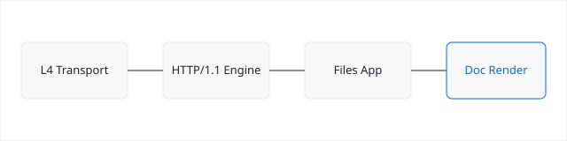

# 快速上手指南

## 安装与启动

```rust
fn main() {
    println!("d server ready");
}
```

```bash
cargo install d
# 服务当前目录
d -r ./public -p 8080
```

## 架构概览与本地图片



<figure>
  
  <figcaption>图 1：纯内建白底文档与协议管线</figcaption>
</figure>

## 原生嵌入式 HTML 与折叠说明

<details>
<summary>点击展开常用快捷键与细节说明</summary>

在文档预览页顶部可直接点击无脚本切换链接，或使用浏览器快捷键 <kbd>Cmd</kbd>+<kbd>F</kbd> 查找文本；完整支持的扩展语法包括：

- [x] 纯 Rust 服务端 Markdown 渲染（零外网 CDN）
- [x] 原生块级与行内嵌入式 HTML 透传
- [x] 中英文标题自动去重锚点

</details>

<table>
  <thead>
    <tr><th>视图模式</th><th>访问路径</th><th>说明</th></tr>
  </thead>
  <tbody>
    <tr><td>文档阅读页</td><td><code>/guide.md</code></td><td>极简白底渲染视图</td></tr>
    <tr><td>原始内容</td><td><code>?view=raw</code></td><td>返回纯文本源码</td></tr>
    <tr><td>媒体查看器</td><td><code>?view=viewer</code></td><td>白底图片与音视频页面</td></tr>
  </tbody>
</table>

## 目录页查询参数与技巧

| 参数 | 作用 | 示例 |
| :--- | :---: | ---: |
| `sort` | 按名称/大小/时间/类型排序 | `?sort=size` |
| `hidden` | 隐藏文件显示开关（需 `--hidden`） | `?hidden=true` |
| `view` | 指定视图模式 | `?view=download` |

1. **断点续传**：`curl -C - -O http://localhost:8080/bigfile.zip`[^range]
2. **下载部分文件**：`curl -r 0-1023 http://localhost:8080/data.bin`
3. **只看头部**：`curl -I http://localhost:8080/data.bin`

[^range]: 静态二进制与媒体裸路径永远直出原始流，完整支持单段与后缀 `Range`。
